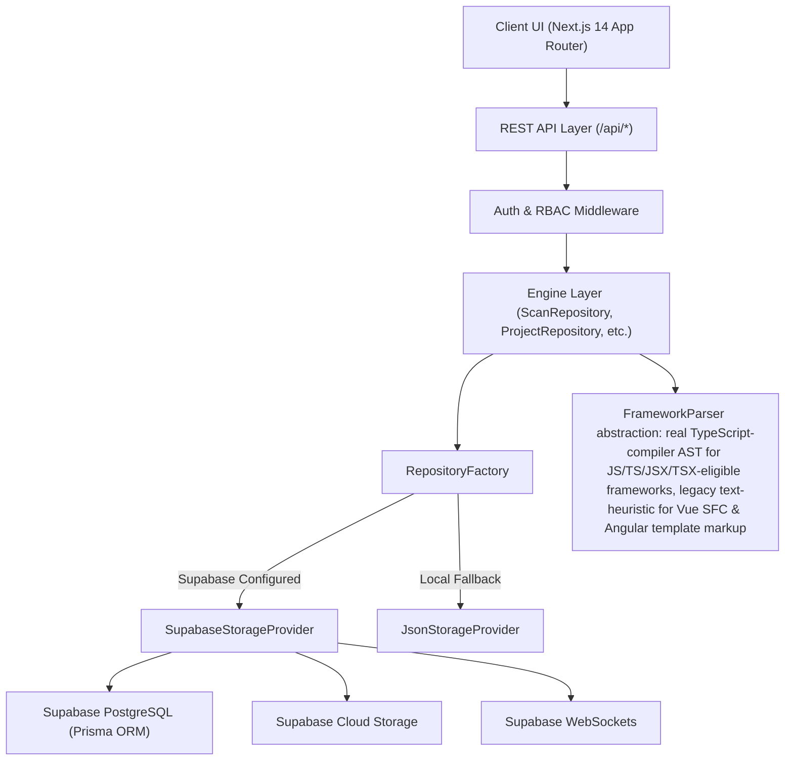

# FIGM Code Inspector — System Architecture & Design Specification

This document presents the architectural topology, design patterns, software layers, and evaluation principles governing the FIGM Code Inspector cloud SaaS platform.

---

## 1. High-Level Architecture

---

## 2. Architectural Principles & SOLID Adherence

1. **Single Responsibility Principle (SRP)**:
   - `SourceParser`: dispatches each file to a real TypeScript-compiler-backed AST builder
     (`src/ast/real-syntax-node-builder.ts`, via `src/parser/typescript-framework-parser.ts`) for
     23 of 25 FIGM rules on the frameworks where that syntax is genuinely parseable (React,
     Next.js, plain JS/TS, and the TypeScript class body of Angular components), and to a
     regex/substring text-heuristic path for the remainder — see
     `docs/architecture/AST_MIGRATION_MAP.md` for the exact rule-by-rule breakdown and rationale.
     Every produced node is labeled `sourceKind: 'REAL_AST' | 'LEGACY_TEXT_HEURISTIC'` so this
     distinction is inspectable in the diagnostics output, not just in source comments.
   - `ALPExtractionEngine`: Normalizes AST into ALP format.
   - `RuleExecutionEngine`: Evaluates ALP nodes against FIGM rules.
   - `ExportService`: Formats inspection reports.

2. **Open/Closed Principle (OCP)**:
   - FIGM guidelines are mapped declaratively via `FOUR_LAYER_MAPPINGS`. New rules can be registered without mutating core parser algorithms.

3. **Liskov Substitution Principle (LSP)**:
   - `JsonStorageProvider` and `SupabaseStorageProvider` implement `IStorageProvider` and can be substituted transparently.

4. **Interface Segregation Principle (ISP)**:
   - Isolated granular repository contracts.

5. **Dependency Inversion Principle (DIP)**:
   - Repositories depend on `IStorageProvider` abstraction rather than database implementations.
