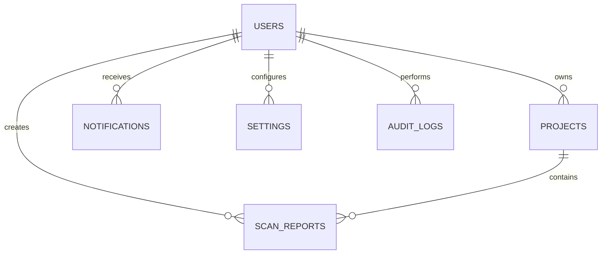

# FIGM Code Inspector — Database & Schema Specification

Overview of database architecture, relational models, Prisma ORM mappings, and how tenant isolation is actually enforced.

---

## 1. Relational Entity Relationship Diagram

---

## 2. Prisma Models & Schema Structure

Defined in [prisma/schema.prisma](./prisma/schema.prisma):

1. **`User`**: Account identity, hashed passwords, roles (`ADMIN`, `DEVELOPER`, `AUDITOR`), and API keys.
2. **`Project`**: Workspaces with framework types and aggregated score metrics.
3. **`ScanReport`**: Detailed code inspection results, execution latency, memory footprint, and diagnostic arrays.
4. **`Notification`**: Real-time user event notifications.
5. **`Settings`**: User preference configuration (dark/light theme, auto-scan, default AI model).
6. **`AuditLog`**: Security audit log records.

---

## 3. Tenant Isolation: Application Layer, Not Postgres RLS

Tenant isolation is enforced at the application/repository authorization layer, not by Postgres
Row-Level Security. Every repository method that reads or writes user-owned data (projects, scan
reports, notifications, settings, submissions, etc.) takes the authenticated request's `userId` as
an explicit parameter and scopes its query to it -- see `src/storage/supabase-storage-provider.ts`
and `src/storage/json-storage-provider.ts`, and the route handlers under `app/api/**` that resolve
`userId` from the verified JWT before calling into either.

`docs/multi_tenant_schema.sql` is a standalone, aspirational RLS design (`CREATE POLICY ... USING
(user_id = current_setting('app.current_user_id', true))`) that was never wired into the real
Prisma migration history (`prisma/migrations/`) and is never applied to the live database. Even if
it were imported, it would provide no real protection as-is: no application code ever runs `SET
app.current_user_id`, so every policy's `current_setting(...)` call would read an unset session
variable, and the app's own Postgres connection (via `SUPABASE_SERVICE_ROLE_KEY`/`DATABASE_URL`) is
a service-role/superuser-equivalent connection that bypasses RLS entirely regardless. Treat that
file as a design sketch for a possible future defense-in-depth layer, not a description of this
deployment's actual security boundary.
