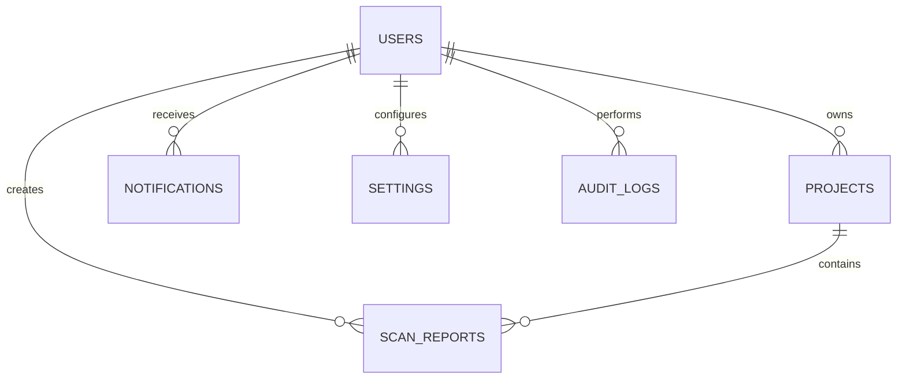

# FIGM Code Inspector — Database & Schema Specification

Overview of database architecture, relational models, Prisma ORM mappings, and Supabase Row-Level Security (RLS) policies.

---

## 1. Relational Entity Relationship Diagram



---

## 2. Prisma Models & Schema Structure

Defined in [prisma/schema.prisma](file:///c:/Users/MSI/.gemini/antigravity-ide/scratch/figm-model/prisma/schema.prisma):

1. **`User`**: Account identity, hashed passwords, roles (`ADMIN`, `DEVELOPER`, `AUDITOR`), and API keys.
2. **`Project`**: Workspaces with framework types and aggregated score metrics.
3. **`ScanReport`**: Detailed code inspection results, execution latency, memory footprint, and diagnostic arrays.
4. **`Notification`**: Real-time user event notifications.
5. **`Settings`**: User preference configuration (dark/light theme, auto-scan, default AI model).
6. **`AuditLog`**: Security audit log records.

---

## 3. Row Level Security (RLS) Assumptions

Supabase PostgreSQL DDL (`docs/multi_tenant_schema.sql`) enforces tenant isolation using Postgres RLS policies:
```sql
CREATE POLICY "Users access own projects" 
ON public.projects FOR ALL 
USING (user_id = current_setting('app.current_user_id', true));
```
