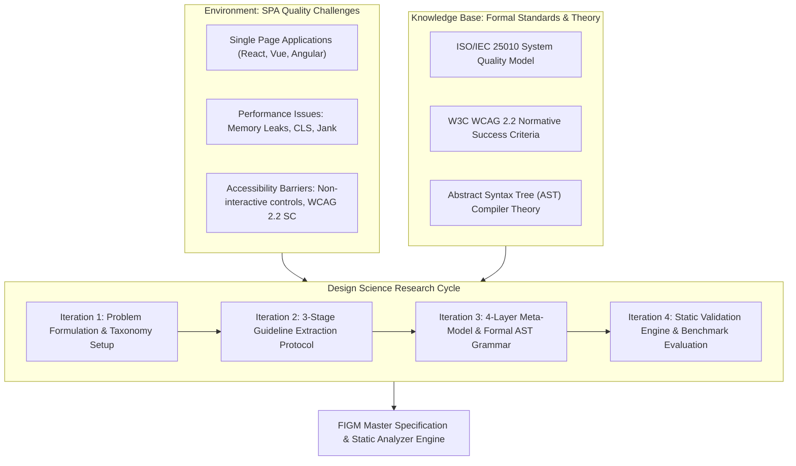

# Chapter 3: Research Methodology & Meta-Model Specification

## 3.1 Design Science Research (DSR) Framework

The development of the Framework-Independent Guideline Model (FIGM) follows the normative **Design Science Research (DSR)** paradigm formulated by Hevner et al. (2004). DSR provides an empirical problem-solving methodology tailored for constructing innovative software artifacts to address complex engineering challenges.



The research workflow progresses through four sequential iterative cycles:
1. **Iteration 1 (Problem Taxonomy)**: Identification of SPA architectural vulnerabilities across Performance and Accessibility domains.
2. **Iteration 2 (Guideline Extraction)**: Execution of a 3-stage sequential filter extracting $N=8$ core guidelines from $N=18$ candidates.
3. **Iteration 3 (Meta-Model Formalization)**: Construction of the 4-layer meta-model hierarchy and formal first-order logic predicates.
4. **Iteration 4 (Artifact Implementation & Empirical Evaluation)**: Construction of the static validation engine and evaluation against benchmark testbed applications.

---

## 3.2 Four-Layer Architecture Meta-Model

To decouple static quality rules from framework-specific syntax variations, FIGM establishes a 4-layer meta-model hierarchy:

$$\text{Domain} \longrightarrow \text{Concern} \longrightarrow \text{Abstract Language Primitive (ALP)} \longrightarrow \text{Rule}$$

```
+-----------------------------------------------------------------------------------+
| LAYER 1: DOMAIN (Performance Efficiency | Accessibility)                          |
+-----------------------------------------------------------------------------------+
                                         |
                                         v
+-----------------------------------------------------------------------------------+
| LAYER 2: CONCERN (Invariant Allocations, Layout Instability, SC 2.1.1, SC 4.1.2)  |
+-----------------------------------------------------------------------------------+
                                         |
                                         v
+-----------------------------------------------------------------------------------+
| LAYER 3: ABSTRACT LANGUAGE PRIMITIVE (ALP-LOOP-ALLOC, ALP-LAYOUT-ELEMENT, etc.)   |
+-----------------------------------------------------------------------------------+
                                         |
                                         v
+-----------------------------------------------------------------------------------+
| LAYER 4: RULE DEFINITION (FIGM-PERF-01..04, FIGM-A11Y-01..04)                      |
+-----------------------------------------------------------------------------------+
```

### 3.2.1 Layer Definitions
1. **Domain Layer**: The highest abstraction level partitioning quality concerns into **Performance Efficiency** (ISO 25010) and **Accessibility** (WCAG 2.2).
2. **Concern Layer**: Specific quality categories (e.g., Invariant Allocations, Layout Instability, Keyboard Accessibility, Status Messages).
3. **Abstract Language Primitive (ALP) Layer**: Framework-agnostic node constructs, conceptually modeled on Abstract Syntax Tree (AST) node types. *(See Chapter 4 §4.2 for the implementation-level distinction. **Correction (Phase 3, Dissertation Integrity, re-verified directly by re-running `RuleExecutionEngine.analyzeFile` against every fixture in `benchmarks/ground-truth.json`):** this sentence previously said "23 of the 25 rules," predating the rule set's growth to 50 and the FIGM-ANG-03/04 and FIGM-VUE-01/02 migrations. As of this correction, **all 50 canonical rules** are extracted from a genuine compiler-derived AST (TypeScript compiler, `@vue/compiler-dom`, or `angular-html-parser`, depending on the rule) for at least one supported framework each. Coverage remains framework-gated, not universal.*

   ***Second correction (final implementation pass, re-verified by direct inspection of every `useRealAst*` eligibility gate in `src/parser/source-parser.ts` and `src/ast/real-syntax-node-builder.ts`, cross-checked against each gate's own documented "Real-AST-migrated for `useRealAst*` frameworks" comment):** the previous "5 rules... Vue SFC and/or Angular template" statement above was itself imprecise — it undercounted the affected rules and did not distinguish two structurally different gating patterns. The accurate picture, confirmed directly against `isJsxRealAstEligible`/`isGeneralJsRealAstEligible`/`isAngularClassRealAstEligible` (`real-syntax-node-builder.ts` lines 29-46) and every corresponding call site in `source-parser.ts`, is:*

   - *6 universal rules (**FIGM-PERF-01, FIGM-PERF-03, FIGM-PERF-04, FIGM-PERF-06, FIGM-REACT-01, FIGM-REACT-03**) use the "general JS" gate (`GENERAL_JS_FRAMEWORKS = [REACT_JSX, NEXT_JS, GENERIC_ESTREE, ANGULAR_TEMPLATE]`) — real-AST on React, Next.js, plain JS/TS, **and** Angular's TypeScript class body; legacy text-heuristic fallback only on Vue SFC.*
   - *9 universal rules (**FIGM-PERF-02, FIGM-PERF-05, FIGM-REACT-04, FIGM-A11Y-01, FIGM-A11Y-02, FIGM-A11Y-03, FIGM-A11Y-04, FIGM-A11Y-05, FIGM-A11Y-06**) use the narrower "JSX" gate (`JSX_FRAMEWORKS = [REACT_JSX, NEXT_JS]`) — real-AST on React/Next.js only; legacy text-heuristic fallback on Angular, Vue, **and** plain JS/TS (`GENERIC_ESTREE`) alike.*
   - *The remaining 35 rules are either framework-scoped by design (the 10 `FIGM-ANG-*` rules apply only to Angular and use `isAngularClassRealAstEligible`/`angular-html-parser`; the 6 `FIGM-VUE-*` rules apply only to Vue and use dedicated `@vue/compiler-dom`-based builders; `FIGM-NEXT-01/02/03/04` are Next.js-scoped) or have no legacy fallback code path left in `source-parser.ts` at all (`FIGM-ANG-06/07/09`, added directly as real-AST with no predecessor to fall back to).*
   - *No rule is real-AST on zero frameworks, and every universal rule is real-AST on at least React and Next.js — but "framework-independent detection" should be read precisely: the shared abstraction (Domain→Concern→ALP→Rule) is genuinely framework-independent, while the **detection mechanism** for 15 of the 50 rules is not yet uniformly real-AST-backed across all four supported frameworks.*
4. **Rule Layer**: Executable detection logic defining compliance rules, severity metrics, and remediation paths.

---

## 3.3 Three-Stage Guideline Extraction Protocol

To ensure rigor, candidate guidelines are subjected to a sequential 3-stage extraction pipeline filtering an initial candidate pool of $N_0 = 18$ guidelines down to a final core set of $N_3 = 8$ rules.

Let $C = \{g_1, g_2, \dots, g_{18}\}$ be the candidate guideline set:

### Stage 1: Framework Independence Protocol
$$\text{Filter}_1(C) = \{ g \in C \mid \text{isFrameworkIndependent}(g) = \text{true} \}$$
Filtering excludes $6$ candidate rules dependent on specific runtime APIs (e.g. React `useEffect` dependency array rules, Vue Options API data return wrappers). Output: $N_1 = 12$.

### Stage 2: Static Detectability Protocol
$$\text{Filter}_2(N_1) = \{ g \in N_1 \mid \text{isStaticallyDetectable}(g) = \text{true} \}$$
Filtering excludes $2$ dynamic runtime-only rules requiring active browser interaction or dynamic server latency monitoring. Output: $N_2 = 10$.

### Stage 3: Standard Traceability Protocol
$$\text{Filter}_3(N_2) = \{ g \in N_2 \mid \text{Traceability}(g) \in \{ \text{ISO\_25010}, \text{WCAG\_2\_2} \} \}$$
Filtering excludes $2$ non-standard stylistic conventions lacking formal normative backing. Final Core Output: $N_3 = 8$.

---

## 3.4 Formal Mathematical Detection Predicates

Let $\mathcal{G}_{\text{AST}} = (N, E)$ denote an AST graph where $N$ is the set of syntax nodes, $\mathcal{S}(n)$ denotes the enclosing scope of node $n \in N$, and $\text{Ancestors}(n)$ represents the set of structural ancestor nodes.

### 3.4.1 FIGM-PERF-01: Invariant Object Allocation in Iteration Scopes
$$\forall n \in N, \quad P_{\text{PERF-01}}(n) \iff \Big( \text{type}(n) \in \{ \text{ObjectExpression}, \text{ArrayExpression}, \text{ArrowFunctionExpression} \} \Big) \land \exists a \in \text{Ancestors}(n) : \Big( \mathcal{S}(a) \in \{ \text{LOOP}, \text{RENDER} \} \Big) \land \neg \text{UsesLoopVariable}(n, a)$$

### 3.4.2 FIGM-PERF-02: Un-dimensioned Dynamic Layout Elements
$$\forall n \in N, \quad P_{\text{PERF-02}}(n) \iff \Big( \text{IsVisualElement}(n) \Big) \land \neg \Big( \text{HasAttr}(n, \text{"width"}) \land \text{HasAttr}(n, \text{"height"}) \Big) \land \neg \text{HasStyle}(n, \text{"aspectRatio"})$$

### 3.4.3 FIGM-PERF-03: Unbounded Event Listener Disposal
$$\forall n \in N, \quad P_{\text{PERF-03}}(n) \iff \Big( \text{IsListenerRegistration}(n) \Big) \land \neg \exists d \in \text{TeardownScope}(\mathcal{S}(n)) : \text{IsPairedRemoval}(n, d)$$

### 3.4.4 FIGM-PERF-04: Static Imports in Deferred Execution Paths
$$\forall n \in N, \quad P_{\text{PERF-04}}(n) \iff \Big( \text{type}(n) = \text{ImportDeclaration} \Big) \land \exists c \in N : \Big( \text{IsConditionalScope}(c) \land \text{ReferencesModule}(c, n) \Big)$$

### 3.4.5 FIGM-A11Y-01: Keyboard Event Parity on Pointer Handlers
$$\forall n \in N, \quad P_{\text{A11Y-01}}(n) \iff \Big( \text{IsNonInteractiveElement}(n) \land \text{HasPointerHandler}(n) \Big) \land \neg \Big( \text{HasKeyboardHandler}(n) \land \text{HasTabIndex}(n) \Big)$$

### 3.4.6 FIGM-A11Y-02: Accessible Name and Role for Custom UI Controls
$$\forall n \in N, \quad P_{\text{A11Y-02}}(n) \iff \Big( \text{IsCustomControl}(n) \Big) \land \neg \Big( \text{HasAttr}(n, \text{"role"}) \land \big( \text{HasAttr}(n, \text{"aria-label"}) \lor \text{HasAttr}(n, \text{"aria-labelledby"}) \big) \Big)$$

### 3.4.7 FIGM-A11Y-03: ARIA Live Announcer for Dynamic Mutations
$$\forall n \in N, \quad P_{\text{A11Y-03}}(n) \iff \Big( \text{IsDynamicStatusContainer}(n) \Big) \land \neg \Big( \text{HasAttr}(n, \text{"aria-live"}) \lor \text{Role}(n) \in \{ \text{"status"}, \text{"alert"} \} \Big)$$

### 3.4.8 FIGM-A11Y-04: Dynamic Focus Containment and Traversal
$$\forall n \in N, \quad P_{\text{A11Y-04}}(n) \iff \Big( \text{IsOverlayOrModal}(n) \Big) \land \neg \Big( \text{HasFocusTrap}(n) \land \text{RestoresFocusOnUnmount}(n) \Big)$$
