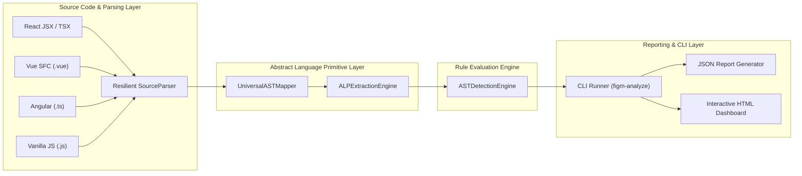
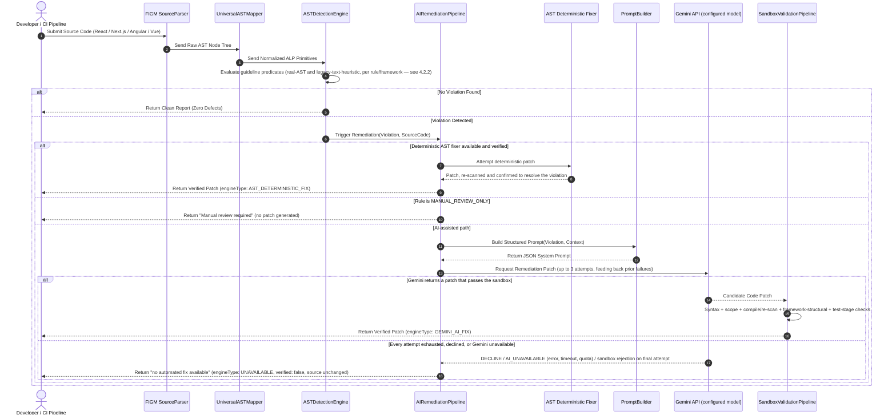

# Chapter 4: System Implementation & Parsing Architecture

## 4.1 Analyzer System Architecture Overview

The FIGM static analysis architecture is organized into four decoupled processing layers:



---

## 4.2 Resilient Source Code Parser Adapter

> **Architecture correction** (see `docs/audit/AST_ARCHITECTURE_AUDIT.md` for the full rule-by-rule
> trace): a prior version of this section described `SourceParser` as producing genuine AST node
> generation for all 25 guideline rules. On inspection of the actual implementation, `SourceParser`
> is a resilient **line/regex-based pattern scanner**: it applies ~22 independent substring/regex
> checks per line (preceded by a real character-level lexer that blanks comment and string-literal
> text to avoid matching inside them) and emits a synthetic, AST-*shaped* intermediate
> representation (`ASTNode` objects with real `type`/`loc`/`attributes` fields) rather than a tree
> produced by parsing the language grammar. 22 of the 25 FIGM rules are pure regex/substring
> matching against this representation; 2 (FIGM-PERF-04, FIGM-A11Y-01) additionally use a
> hand-rolled brace-depth-tracking heuristic for better resilience to multi-line formatting. As of
> this audit, exactly 1 rule (FIGM-REACT-02, on React/Next.js files) is evaluated against a
> genuine TypeScript-compiler-derived AST (`src/analysis/react-ast-rules.ts`) — see §4.2.2. The
> accurate characterization of the overall system is **AST-informed pattern-based static
> analysis**, with a growing genuine-AST-based subset, not a uniformly AST-based tool.
>
> **Update (AST migration, see `docs/architecture/AST_MIGRATION_MAP.md`):** the "growing" subset
> above is no longer just FIGM-REACT-02. 15 of the 25 rules (FIGM-PERF-01/02/04, FIGM-A11Y-01/02/03/04,
> FIGM-NEXT-01/02/03/04, FIGM-REACT-02/03, FIGM-ANG-01/02/05) are now detected via a real
> `ts.createSourceFile`-backed parser (`src/parser/typescript-framework-parser.ts` +
> `src/ast/real-syntax-node-builder.ts`) for the frameworks where that syntax is genuinely
> TypeScript/JSX (React, Next.js, plain JS/TS, and Angular's TypeScript class body). The remaining
> 10 rules (FIGM-PERF-03/05/06, FIGM-A11Y-05/06, FIGM-REACT-01/04, FIGM-ANG-03/04) are still
> regex/substring, as is *every* rule when applied to a Vue SFC or to Angular's template markup
> (the TypeScript compiler cannot parse either). Every diagnostic now carries a `sourceKind` field
> (`REAL_AST` or `LEGACY_TEXT_HEURISTIC`) recording which mechanism actually produced it, so this
> claim is independently checkable against the tool's own live output, not only against this text.
> The system is still, honestly, a hybrid — "AST-based" is accurate for a specific, documented
> majority of rule/framework combinations, not for the tool as a uniform whole.
>
> **Further update (see `docs/architecture/RULE_ENGINEERING_AUDIT.md`):** the migration continued
> past the 15/16-rule snapshot above. As of this audit, **23 of the 25 rules** are real-AST for
> their eligible frameworks (up from 16/25 at the previous update). Only **FIGM-ANG-03** and
> **FIGM-ANG-04** (Angular's `*ngFor trackBy` and template method-call rules — both operate on
> Angular *template markup*, not the TypeScript class body) remain permanently
> `LEGACY_TEXT_HEURISTIC` on every framework, pending an `@angular/compiler` integration to parse
> that syntax for real. Vue SFC still has zero real-AST coverage across all 25 rules for the same
> reason (the TypeScript compiler cannot parse Vue templates). The `sourceKind` field described
> above remains the source of truth for which mechanism produced any given diagnostic.
>
> **Latest correction (Phase 3, Dissertation Integrity — re-verified directly by re-running
> `RuleExecutionEngine.analyzeFile` against every fixture in `benchmarks/ground-truth.json` and
> reading each returned diagnostic's own `sourceKind` field, not assumed from the narrative
> above):** the rule set has since grown to **50 canonical rules** (`figm-spec.json`'s
> `meta.totalCoreRules`), and the "23 of 25" / "Vue SFC has zero real-AST coverage" claims above no
> longer hold at all — both were superseded by `angular-html-parser` (FIGM-ANG-03/04/08/10) and
> `@vue/compiler-dom`/a real TypeScript parse of the `<script>` block (all 6 Vue rules) integrations
> that post-date this section's last update. As of this correction, **all 50 canonical rules** are
> real-AST for at least one supported framework — zero rules are permanently
> `LEGACY_TEXT_HEURISTIC` on every framework. Coverage remains framework-gated, not universal:
> FIGM-A11Y-01, FIGM-A11Y-03, FIGM-PERF-01, FIGM-PERF-02, and FIGM-PERF-03 detect via real AST on
> React/Next.js/plain JS-TS but still fall back to text-heuristic scanning specifically on Vue SFC
> and/or Angular template files. The `sourceKind` field remains the live, independently-checkable
> source of truth for any specific diagnostic.

Static analysis of modern web applications requires handling heterogeneous template syntaxes and incomplete or malformed code blocks. The `SourceParser` adapter provides resilient pattern-based parsing that produces an AST-shaped intermediate representation:

```typescript
export class SourceParser {
  public static parseSource(code: string, filePath: string): ParseResult {
    const framework = this.detectFramework(filePath, code);
    const errors: Array<{ line: number; column: number; message: string }> = [];

    try {
      const rootNode = this.buildASTFromCode(code, framework, errors);
      return { filePath, framework, ast: rootNode, parseErrors: errors };
    } catch (err) {
      errors.push({ line: 1, column: 1, message: err instanceof Error ? err.message : 'Syntax error' });
      return { filePath, framework, ast: { type: 'Program', children: [] }, parseErrors: errors };
    }
  }
}
```

### 4.2.1 Framework Detection Matrix
The parser inspects file extensions and structural syntax keywords:
* `.tsx`, `.jsx`, or `import React`: Mapped to `REACT_JSX`.
* `.vue`: Mapped to `VUE_SFC`.
* `.component.ts` or `@Component`: Mapped to `ANGULAR_TEMPLATE`.
* `.js` or `.ts`: Mapped to `GENERIC_ESTREE`.

### 4.2.2 Genuine AST Migration (Stage A: React / Next.js)

FIGM-REACT-02 ("array index used as a React list `key`") is evaluated against a real
TypeScript-compiler-derived AST (`ts.createSourceFile` + a scope-aware visitor,
`src/analysis/react-ast-rules.ts`) for `REACT_JSX`/`NEXT_JS` files, in place of the pattern-based
predicate used for every other rule. This required understanding real parameter binding: the
predicate walks up from each JSX `key` attribute to find the nearest enclosing `.map((item, N) =>
...)` callback and checks whether the key's expression is exactly a reference to that callback's
own index parameter `N` — a real scope question a line-pattern check cannot answer, because it
depends on where an identifier is bound, not what it is spelled.

This directly fixes two concrete, demonstrated defects in the pattern-based version (both proven
in `tests/react-ast-rules.test.ts`, which asserts the pattern-based engine's actual behavior on
each case, not a hypothetical):
- **False positive**: a local variable that happens to be named `index` but is *not* the loop's
  index parameter (e.g. `const index = computeSomething();`) was flagged by the substring check
  `key={index}` regardless of where `index` came from. The real-AST version correctly does not
  flag it, since no enclosing `.map()` callback binds an `index` parameter in that case.
- **False negative**: an index parameter named anything other than the three names the
  pattern-based version hardcodes (`index`, `i`, `idx`) — e.g. `.map((item, position) => ...)` —
  was invisible to it. The real-AST version detects the violation regardless of the parameter's
  name, and additionally recognizes a template-literal key derived solely from the index (e.g.
  `` key={`row-${index}`} ``), which contains no occurrence of the literal substring the
  pattern-based check searches for.

This is deliberately scoped to one rule and two frameworks as the first increment of a staged
migration (Stage A → B: Next.js-specific rules → C: Angular, requiring `@angular/compiler` → D:
Vue, requiring `@vue/compiler-sfc` → E: a common intermediate representation once at least two
real per-framework parsers exist to abstract over). See `docs/audit/AST_ARCHITECTURE_AUDIT.md` for
the full rule-by-rule classification of all 25 rules and the complete migration plan.

---

## 4.3 ALP Extraction Engine

The `ALPExtractionEngine` traverses normalized AST node graphs and maps framework-specific syntactic constructs (e.g. React `onClick` attributes, Vue `v-on:click` directives, Angular `(click)` output bindings) to generic FIGM Abstract Language Primitives (ALPs):

| Framework Syntax | Native Node Type | Extracted FIGM ALP Target |
| :--- | :--- | :--- |
| `<div onClick={fn}>` | `JSXElement` | `ALP-EVENT-KEYBOARD` |
| `` | `JSXElement` / `VElement` / `Element$1` | `ALP-LAYOUT-ELEMENT` |
| `window.addEventListener('scroll', fn)` | `CallExpression` | `ALP-ASYNC-DISPOSAL` |
| `items.map(() => ({ item }))` | `CallExpression` + `ObjectExpression` | `ALP-LOOP-ALLOC` |
| `<CustomSelect />` | `JSXElement` | `ALP-ARIA-NAMING` |

---

## 4.4 Static Analyzer Rule Execution Engine

The `RuleExecutionEngine` coordinates static scanning across target directory trees. It parses each file, extracts ALPs, evaluates all 25 mathematical predicates, and accumulates structured `DiagnosticReport` records:

```typescript
export interface DiagnosticReport {
  ruleId: string;
  ruleName: string;
  domain: 'PERFORMANCE' | 'ACCESSIBILITY';
  concern: string;
  severity: 'CRITICAL' | 'HIGH' | 'MEDIUM' | 'LOW';
  filePath: string;
  location: { start: { line: number; column: number }; end: { line: number; column: number } };
  offendingCodeSnippet: string;
  message: string;
  remediation: string;
  standardReference: string;
}
```

---

## 4.5 CLI Runner & Interactive Dashboard Exporters

The analyzer exposes a command-line interface executable (`figm-analyze`):

```bash
# Scan target application directory and generate both JSON & HTML reports
figm-analyze ./src --format both --out figm-scan-report
```

### 4.5.1 Report Exporters
- **JSON Exporter**: Generates structured machine-readable JSON files (`figm-scan-report.json`) for CI/CD integration pipelines.
- **HTML Dashboard Exporter**: Generates self-contained interactive web dashboards (`figm-scan-report.html`) featuring CSS severity badges, score summary widgets, code snippet syntax displays, and standard traceability mappings.

---

## 4.6 AI-Assisted Remediation Sequence

**Correction (this audit pass, verified live against the running application — see the Live E2E Production Verification Report):** an earlier version of this section described an architecture where a syntax/validation failure or a Gemini API error triggers an automatic fallback to a deterministic engine (`RemediationEngine`) that always returns a patch. That is no longer how the system behaves, and `AIRemediationPipeline`'s own source header now states so explicitly: "There is deliberately NO fourth path... it never falls back to the legacy regex-based RemediationEngine to manufacture a plausible-looking 'fixed' result." This was confirmed live during this audit: a genuine Gemini quota-exhaustion (HTTP 429) on a real request returned `verified: false`, `verificationStatus: 'UNRESOLVED'`, `engineType: 'UNAVAILABLE'`, and the original source byte-for-byte unchanged — not a fallback patch.

The AI remediation pipeline (`AIRemediationPipeline`) actually resolves each violation via exactly one of three paths, tried in order:

1. **AST Deterministic Fix** — a real AST-based fixer (TypeScript/TSX AST, Angular-template AST, or Vue SFC AST, depending on rule and framework) already produced a patch for this specific instance; it is verified via re-scan before being accepted. This is a first-choice path tried *before* Gemini is ever called, not a fallback after Gemini fails.
2. **Manual Review** — a small set of rules (`FIGM-NEXT-08`, `FIGM-NEXT-09`, `FIGM-REACT-06`) are rule-level `MANUAL_REVIEW_ONLY`: no patch is generated by any engine, automatically or otherwise.
3. **Gemini AI-Assisted** — reached when no deterministic fixer exists or succeeded for this instance. Every Gemini-authored patch passes through a sandbox validation pipeline (syntax check → patch-scope check → TypeScript compile + FIGM re-scan → framework-structural check → associated test when one exists) before acceptance. A patch that fails validation gets one bounded retry with the exact failure fed back to the model (up to 3 total attempts). If every attempt is exhausted, declined, or Gemini itself is unavailable (network error, timeout, quota exhaustion), the pipeline returns a terminal "no automated fix available" result — the original code is returned unchanged, and no other engine is invoked to manufacture a substitute patch.

The Gemini model itself is configured via the `GEMINI_MODEL` environment variable (default: `gemini-3.6-flash` at time of writing) rather than hardcoded, since the specific model version is expected to change over the project's life.


