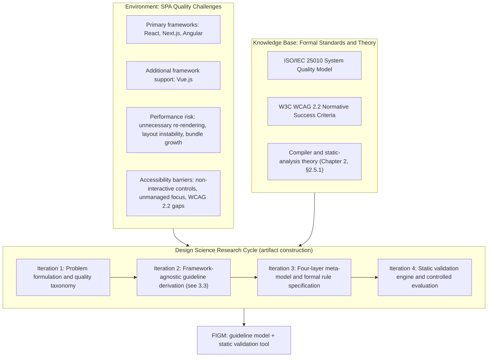

# Chapter 3: Research Methodology

## 3.1 Research Paradigm and Approach

This research adopts **pragmatism** as its guiding research paradigm. Pragmatism is concerned with producing a practical, workable solution to a real-world problem rather than with testing a single theoretical position in isolation, and it accommodates the combination of data sources this research draws on — literature and standards synthesis, artifact construction, controlled experimentation, static analysis of real repositories, expert judgment, and participant feedback — under one coherent research programme. This is the same paradigm stated in the Research Proposal (§3.1) and reproduced without material change in Interim Submission 02 (§3.1); it is preserved here as the authoritative paradigm for this dissertation.

Distinct from the paradigm is the **research approach**, which this dissertation states as **deductive**: existing, established theory — software quality models, accessibility standards, compiler and program-analysis theory, and prior empirical software engineering practice (Chapter 2) — is applied to a new, specific research problem (Chapter 1, §1.3), rather than a new theory being induced from data collected without prior structure. The four research questions (Chapter 1, §1.4) and their associated objectives (Chapter 1, §1.7) were derived from this existing body of knowledge and from the research gap Chapter 2 (§2.6) establishes, and the empirical work reported in Chapters 5 and 6 tests the resulting artifact against that pre-established structure rather than deriving the structure after the fact.

The paradigm and the approach are distinct from, and both precede, the **research strategy** — Design Science Research — which §3.2 presents as the concrete methodological vehicle through which this dissertation's pragmatist paradigm and deductive approach are actually carried out.

## 3.2 Research Strategy — Design Science Research

This dissertation adopts **Design Science Research (DSR)** as its research strategy, following the formulation of Hevner et al. [3], who frame the construction of an innovative software artifact — in this case, the Framework-Agnostic Guideline Model (FIGM) and its automated validation tool — as a legitimate mode of research contribution in its own right, evaluated by whether the resulting artifact demonstrably addresses a real, previously unresolved or incompletely resolved problem. Peffers et al. [10] operationalise this into a six-activity process — problem identification and motivation, definition of objectives for a solution, design and development, demonstration, evaluation, and communication — which this dissertation's own structure mirrors directly: the problem and objectives are established in Chapter 1 and Chapter 2, the artifact's design and development are reported in this chapter and Chapter 4, demonstration and evaluation are reported in Chapter 5, and Chapter 6 constitutes the communication of results, including an honest account of what remains incomplete at the time of writing, not only what has been finished.

A commitment this dissertation treats as binding, following directly from Peffers et al.'s process, is that the *evaluation* activity must be reported with the same rigour as the *design* activity — an evaluation section that is thinner or less carefully scoped than the design it evaluates is not treated as an acceptable outcome. This governs the structure of §§3.4–3.9 below: each evaluation strand (RQ1's experiment, RQ3's repository evaluation, RQ4's expert-validation protocol, the internal controlled benchmark, and the supplementary human study) is specified with the same level of procedural detail as the artifact-design material in §3.3, and the boundary between what each strand can and cannot establish is stated explicitly rather than left implicit.

Figure 3.1 summarises the DSR cycle as applied to this research's own artifact-construction process. Its four iterations describe the phases through which FIGM itself — the guideline model and its detection engine — was designed and built; they are a statement about artifact construction, not a restatement of RQ1–RQ4 as research questions. The explicit mapping from research question to methodology section is stated separately, immediately below the figure, precisely so the two are not conflated.



**Figure 3.1.** Design Science Research cycle applied to FIGM's construction.

**Research-question-to-methodology mapping.** RQ2 (framework-agnostic architectural and accessibility patterns) is addressed by the artifact-design work in §3.3; RQ1 (rendering/state-management influence on FCP/TTI) is addressed by the controlled experiment in §3.4; RQ3 (pre-deployment detection effectiveness) is addressed by the real-world repository evaluation in §3.5; and RQ4 (accuracy against independent expert review) is addressed by the protocol in §3.6, kept explicitly distinct from the internal controlled benchmark in §3.7. The supplementary human usability study (§3.8) does not answer any of RQ1–RQ4 directly; it is a separate, supplementary evaluation of the tool's usability.

## 3.3 Framework-Agnostic Guideline Model — Formal Specification

This dissertation refers to its central artifact as the **Framework-Agnostic Guideline Model (FIGM)**, consistent with the official research title and with RQ2's own wording (Chapter 1, §1.4). Within the project's own implementation artifacts, "Framework-Independent Guideline Model" is used interchangeably to name the identical concept and the identical FIGM acronym; this equivalence is noted once here, at the point the model is formally defined, rather than left for a reader to infer.

### 3.3.1 The Four-Layer Meta-Model

To decouple a quality guideline's underlying semantic concern from any single framework's syntax — the design problem Chapter 2 (§2.5.2) develops in detail — FIGM organises every guideline through a four-layer hierarchy:

$$\text{Domain} \longrightarrow \text{Concern} \longrightarrow \text{Abstract Language Primitive (ALP)} \longrightarrow \text{Rule}$$

1. **Domain Layer.** The highest level of abstraction, partitioning quality concerns into **Performance Efficiency**, grounded in ISO/IEC 25010 [1], and **Accessibility**, grounded in WCAG 2.2 [2].
2. **Concern Layer.** Specific quality categories within a domain (for example, Invariant Allocations and Layout Instability within Performance Efficiency; Keyboard Accessibility and Status Messages within Accessibility).
3. **Abstract Language Primitive (ALP) Layer.** Framework-agnostic node constructs, conceptually modelled on Abstract Syntax Tree node types, that express *what* a rule is looking for independently of any one framework's concrete syntax (Chapter 4, §4.2 gives the implementation-level detail).
4. **Rule Layer.** Executable detection logic — the point at which an ALP is projected onto a specific framework's real, compiler-derived AST and evaluated against a formal predicate (§3.3.3 gives representative examples).

The canonical rule catalogue this model currently defines carries version identifier `ruleSetVersion 2.1.0` and comprises **50 canonical rules**, spanning Accessibility, Architecture, and Static Performance concerns across the primary frameworks (React, Next.js, Angular) with additional coverage for Vue.js. Detection-mechanism coverage is documented per rule rather than asserted as a blanket property: every one of the 50 rules has genuine, compiler-derived real-AST detection (via the TypeScript compiler API, `@vue/compiler-dom`, or `angular-html-parser`, depending on the rule and framework) on at least one supported framework, though this coverage is framework-gated rather than uniform across all four supported frameworks for every rule — a small number of universal rules fall back to an earlier text-heuristic detector on frameworks outside their primary real-AST gate. This distinction — the shared Domain→Concern→ALP→Rule abstraction is framework-agnostic by construction, while the *detection mechanism* implementing a given rule is not always uniformly real-AST-backed across every framework — is treated as a first-order scoping statement, not an implementation footnote, and Chapter 5 reports it accordingly.

### 3.3.2 Guideline Derivation Methodology

Each canonical rule was arrived at through the following methodology, applied consistently across the catalogue:

1. **Literature and standards synthesis** (Chapter 2) — identifying a candidate architectural or accessibility concern from the reviewed literature, from ISO/IEC 25010 [1], or from a specific WCAG 2.2 [2] success criterion.
2. **Framework-independent semantic-concern identification** — stating the concern at the level of the underlying architectural or accessibility principle (Chapter 2, §2.5.2), independent of any single framework's syntax.
3. **Framework applicability mapping** — determining which of this dissertation's primary frameworks (React, Next.js, Angular) and, where relevant, Vue.js as additional support, the concern actually applies to, since not every concern is meaningful in every framework (for example, a concern specific to Angular's change-detection model has no React or Vue counterpart).
4. **AST-detectability assessment** — determining whether, and to what extent, the concern can be checked by static inspection of source code at all (Chapter 2, §2.5.2's conceptual-guideline-vs-executable-rule distinction), and, where only a partial or heuristic static check is possible, recording that limitation explicitly rather than implying complete detection.
5. **Rule formalisation** — expressing the concern as a Concern/ALP pairing and, where the concern is precise enough to admit one, a formal detection predicate (§3.3.3).
6. **Implementation** — projecting the formalised rule onto each applicable framework's real AST (Chapter 4).
7. **Controlled validation and regression** — verifying the rule's behaviour against hand-authored positive and negative fixtures (§3.7) and the project's automated test suite, so that a rule's detection behaviour can be re-checked mechanically as the codebase evolves.

This seven-step methodology, not a single fixed numeric filtering sequence, is the accurate account of how the current 50-rule catalogue was derived and is maintained. An earlier internal draft of this chapter described a different, three-stage numeric filter reducing an initial candidate pool of 18 guidelines to a final set of 8 — that description predates the catalogue's growth to 50 rules and is not an accurate account of the current, or actual historical, derivation of the full rule set; it has been retired rather than preserved, since the evidence available does not support extending that specific numeric pipeline to the present 50-rule catalogue, and inventing an extension to it would misrepresent the derivation history.

### 3.3.3 Representative Formal Predicates

The following predicates illustrate how a Rule-Layer definition is expressed formally, using $\mathcal{G}_{\text{AST}} = (N, E)$ to denote an AST graph with node set $N$, $\mathcal{S}(n)$ for the enclosing scope of node $n \in N$, and $\text{Ancestors}(n)$ for the set of structural ancestor nodes. These four rules are shown as **illustrative examples only** — the complete, current specification of all 50 canonical rules is maintained in the project's canonical rule registry (`figm-spec.json`) and reproduced in full in Appendix [TBD: appendix reference to be finalised at the figures/tables/appendices stage].

**FIGM-PERF-01 (Invariant Object Allocation in Iteration Scopes):**
$$\forall n \in N,\ P_{\text{PERF-01}}(n) \iff \big(\text{type}(n) \in \{\text{ObjectExpression}, \text{ArrayExpression}, \text{ArrowFunctionExpression}\}\big) \land \exists a \in \text{Ancestors}(n) : \big(\mathcal{S}(a) \in \{\text{LOOP}, \text{RENDER}\}\big) \land \neg\,\text{UsesLoopVariable}(n, a)$$

**FIGM-PERF-02 (Un-dimensioned Dynamic Layout Elements):**
$$\forall n \in N,\ P_{\text{PERF-02}}(n) \iff \big(\text{IsVisualElement}(n)\big) \land \neg\big(\text{HasAttr}(n,\text{"width"}) \land \text{HasAttr}(n,\text{"height"})\big) \land \neg\,\text{HasStyle}(n,\text{"aspectRatio"})$$

**FIGM-A11Y-01 (Keyboard Event Parity on Pointer Handlers):**
$$\forall n \in N,\ P_{\text{A11Y-01}}(n) \iff \big(\text{IsNonInteractiveElement}(n) \land \text{HasPointerHandler}(n)\big) \land \neg\big(\text{HasKeyboardHandler}(n) \land \text{HasTabIndex}(n)\big)$$

**FIGM-A11Y-02 (Accessible Name and Role for Custom UI Controls):**
$$\forall n \in N,\ P_{\text{A11Y-02}}(n) \iff \big(\text{IsCustomControl}(n)\big) \land \neg\big(\text{HasAttr}(n,\text{"role"}) \land (\text{HasAttr}(n,\text{"aria-label"}) \lor \text{HasAttr}(n,\text{"aria-labelledby"}))\big)$$

### 3.3.4 Scope Boundaries

Two boundaries are stated explicitly here, since §§3.4–3.9 describe methodologies on both sides of them:

**Accessibility scope.** FIGM's accessibility rules cover a **statically detectable subset of WCAG 2.2-aligned concerns**. This is not a complete WCAG 2.2 conformance checker: some success criteria are checkable directly from source code, some only partially or heuristically, and some require an understanding of visual layout or user intent that static analysis of source code does not have access to (Chapter 2, §2.5.2). No claim of full WCAG 2.2 conformance is made anywhere in this dissertation.

**Performance scope.** FIGM's static performance rules identify **source-code risk indicators** associated with a class of performance defect (for example, an object re-allocated on every render). They are **not** a measurement of First Contentful Paint, Time to Interactive, or any other Core Web Vital. A measured FCP/TTI value can only be obtained by executing the application in a real browser, which is precisely the separate methodology §3.4 describes for RQ1. This chapter maintains this boundary throughout: nowhere in §§3.4–3.9 is a static finding treated as if it were a runtime measurement, or vice versa.

## 3.4 RQ1 — Controlled Rendering and State-Management Experiment

RQ1 asks how different SPA rendering and state-management strategies influence FCP and TTI. This is investigated through a controlled, factorial experiment rather than through static analysis, since FCP and TTI can only be obtained by measuring a real browser's execution of the application.

**Design.** A 2×2 factorial design crosses rendering strategy against state-management strategy, yielding four experimental conditions:

| Condition | Rendering strategy | State-management strategy |
|---|---|---|
| `CSR_LOCAL` | Client-side rendering (CSR) | Local component state |
| `CSR_GLOBAL` | Client-side rendering (CSR) | Global/shared state |
| `SSR_LOCAL` | Server-side rendering (SSR) | Local component state |
| `SSR_GLOBAL` | Server-side rendering (SSR) | Global/shared state |

**Independent variables:** rendering strategy (CSR vs. SSR) and state-management strategy (local vs. global). **Dependent variables:** First Contentful Paint (FCP) and Time to Interactive (TTI), the two metrics RQ1 itself names. All four conditions are implemented as four routes of one otherwise identical Next.js/React fixture application, so that rendering and state-management strategy are the only variables that differ between conditions; all other application content is held constant.

**Instrument.** Google Lighthouse [23] is used to obtain FCP and TTI, via its `first-contentful-paint` and `interactive` audits, under Lighthouse's own desktop configuration preset (not a hand-assembled set of throttling flags), launched through a headless Chrome instance for each run.

**Protocol.** The experiment protocol is frozen in `research/rq1-experiment/protocol.json` and documented in full in `docs/research/RQ1_EXPERIMENT_PROTOCOL.md`. It specifies: a production build of the fixture application (never a development server); a fresh Chrome instance per run, including warm-up runs; one warm-up run per condition, executed for real and recorded but excluded from measured statistics by default; ten measured runs per condition; and a fixed, non-randomised run order. This yields 4 warm-up executions plus 40 measured executions, 44 browser executions in total per full protocol pass.

**Canonical dataset decision.** Two independent executions of this identical, frozen protocol exist. Consistent with the resolution recorded in `research/thesis/THESIS_BLOCKER_RESOLUTION.md` (Decision 1): the first collection is treated as the **PRIMARY** dataset, and the second, later collection — verified to have used the identical protocol, environment, and unmodified fixture/runner code — is treated as a **REPLICATION** dataset. The two datasets are never pooled, and no result is reported by selectively preferring whichever dataset shows more favourable values. Numeric FCP/TTI results from either dataset are reported in Chapter 6, not in this methodology chapter.

**Analysis.** Analysis is descriptive only: mean, standard deviation, minimum, and maximum FCP and TTI per condition, computed per dataset. No inferential significance test (e.g., a t-test or ANOVA) is computed or claimed, because the frozen analysis protocol does not define one; a reported difference in condition means is accordingly never presented as a statistically significant difference in this dissertation.

## 3.5 RQ3 — Real-World Repository Evaluation

RQ3 asks how effectively FIGM's static validation tool detects architectural and accessibility violations in SPA source code before deployment. This is investigated by running the tool, unmodified, against a corpus of real, publicly available open-source SPA repositories.

**Target and final corpus design.** The Research Proposal and Interim Submission 02 specify a target of 20–30 public open-source SPA repositories. The corpus used for this evaluation comprises **21 repositories**, structured as:

| Group | Frameworks | Repository count |
|---|---|---|
| Primary | React | 5 |
| Primary | Next.js | 5 |
| Primary | Angular | 5 |
| **Primary subtotal** | | **15** |
| Additional | Vue.js | 3 |
| Additional | Generic JavaScript/TypeScript (non-SPA-framework) | 3 |
| **Additional subtotal** | | **6** |
| **Total** | | **21** |

**Inclusion logic.** Each repository is a publicly available, open-source GitHub repository, pinned to a specific commit at the time it was cloned for evaluation, so that the exact source snapshot evaluated is reproducible independently of later upstream changes. Each repository is classified by its primary framework (React, Next.js, Angular, Vue, or generic) at the point of inclusion, and this classification determines whether it counts toward the primary or additional group above.

**Source scanning process.** For each repository, source files are collected recursively, each file is passed through FIGM's framework-detection and parsing layer, and applicable rules are executed against the resulting representation, exactly as described for a single file in §3.3 and Chapter 4. Files that fail to parse are counted and recorded as parse errors rather than silently skipped or treated as passing; any engine-level crash during a repository's scan is likewise counted rather than discarded.

**Aggregation.** Per-repository results (files scanned, lines of code, parse errors, engine crashes, findings by rule and by domain) are aggregated into a combined summary across the full corpus.

**What this methodology does and does not establish.** This evaluation strand is designed to characterise FIGM's **detection activity, coverage, and robustness** when run against real, unmodified, third-party source code — whether it completes without crashing, how many files it can parse, which rules actually trigger in practice, and how findings distribute across domains. It is explicitly **not** designed to establish an accuracy figure: no independently labelled ground truth exists for this corpus, so no Precision, Recall, or F1-score is computed or claimed from it. That question — whether a given finding is correct — is addressed by the separate methodologies in §3.6 (RQ4) and §3.7 (the internal controlled benchmark), not by this one. Aggregate finding totals from this evaluation are reported in Chapter 6, not here.

## 3.6 RQ4 — Independent Expert Validation

RQ4 asks to what extent the validation tool achieves acceptable accuracy when compared against manual expert architectural review, using Precision, Recall, and F1-score. This requires comparison against real, independent human judgment — a requirement this dissertation treats as mandatory for RQ4, not optional.

**Protocol design.** An independent annotation package was constructed comprising **67 source-code cases**, each evaluated against the applicable subset of the 50-rule canonical catalogue, yielding **1,717 case × rule candidate-judgment rows** in total. The package is frozen (versioned, with a fixed manifest) so that the exact material any annotator works from is reproducible and auditable.

**Blinding.** Annotators evaluate the 67 cases without seeing FIGM's own output for them, and without being told in advance which cases are clean and which contain a genuine violation, so that an annotator's judgment is not primed by the tool being evaluated.

**Judgment labels.** For each case×rule row, an annotator records one of three labels: `VIOLATION`, `NO_VIOLATION`, or `AMBIGUOUS`. `AMBIGUOUS` rows are excluded from the Precision/Recall/F1 calculation below, with the reason for ambiguity preserved rather than discarded, so that an unclear case is never forced into a binary label it does not actually support.

**Metrics.** Once real annotation data exists, accuracy against the expert-labelled rows (excluding `AMBIGUOUS`) is computed as:

$$\text{Precision} = \frac{TP}{TP + FP}, \qquad \text{Recall} = \frac{TP}{TP + FN}, \qquad F_1 = \frac{2 \cdot \text{Precision} \cdot \text{Recall}}{\text{Precision} + \text{Recall}}$$

where a true positive is a case×rule row where FIGM's finding and the expert's `VIOLATION` judgment agree, a false positive is a row where FIGM reports a violation the expert judges `NO_VIOLATION`, and a false negative is a row where the expert judges `VIOLATION` but FIGM reports none.

**Status.** This protocol constitutes the *design* of RQ4's evaluation. Whether the protocol has been executed — that is, whether a real, independent human expert has completed and submitted annotations under it — is a data-collection outcome, not a property of the methodology itself, and is reported as such in Chapter 6 rather than in this chapter.

**Explicit separation from the internal controlled benchmark.** The internal controlled benchmark described in §3.7 is never used as evidence toward RQ4. RQ4 specifically and exclusively requires comparison against an annotator independent of the party that built and tuned the detector under test; the internal benchmark, by construction, does not meet that requirement (§3.7).

## 3.7 Internal Controlled Benchmark

Independently of RQ4, an internal controlled benchmark evaluates whether FIGM's rules behave as their own formal specifications (§3.3.3) intend, against a fixture set the research team itself authored.

**Fixtures and ground truth.** `benchmarks/testbed/` contains source-code fixtures written specifically to exercise the canonical rule catalogue; `benchmarks/ground-truth.json` records the corresponding hand-labelled set of expected violations — file path, rule identifier, and expected location — for those fixtures. Ground-truth coverage spans the full 50-rule catalogue: every canonical rule has at least one hand-labelled fixture instance in the ground-truth set.

**Scoring.** The benchmark is scored by a dedicated evaluation script that re-runs FIGM's rule-execution engine against every file in the fixture set and diffs the resulting diagnostics against the ground-truth set by exact file-path and rule-identifier match; no cached or hand-typed confusion matrix is used at any step. A true positive is a ground-truth entry with a matching diagnostic; a false negative is a ground-truth entry with no matching diagnostic; a false positive is any diagnostic FIGM produces that has no corresponding ground-truth entry. Precision, Recall, and F1-score are then computed using the identical formulas stated in §3.6.

**What this benchmark is, and is not.** This is an **internal controlled benchmark**: both the fixtures and the ground truth labelling them were authored by the same party that built the detectors under test. It is a legitimate, genuine measurement of internal consistency — whether a rule's implementation matches its own intended specification — obtained deterministically and reproducibly. It is **not** independent external validation, and it does not, and cannot, substitute for the independent expert comparison RQ4 requires (§3.6). This distinction is treated as a first-order methodological statement here, and is repeated, not softened, wherever this benchmark's results are eventually reported (Chapter 5). Consistent with the instruction to keep this chapter methodology-only, no numeric Precision/Recall/F1 outcome from this benchmark is stated here; the outcome, and its full circularity disclosure, is reported in Chapter 5.

## 3.8 Supplementary Human Usability Study

Independently of RQ1–RQ4, a supplementary study evaluates the tool's usability from a developer's perspective. This study does not answer any of RQ1–RQ4 and is not a substitute for RQ4's independent expert validation (§3.6); its role is limited to the usability question it is actually designed to answer.

**Target.** The final target for this study is **20 real participants**, identified pseudonymously within the research dataset as `P001` through `P020`. This is a revision of an earlier, larger baseline target of 80–100 student developers stated in the Research Proposal and Interim Submission 02; the reduction to 20 was a later, approved research-scope decision, documented in `docs/research/PARTICIPANT_TARGET_DECISION.md`, and 20 is the operative target this dissertation reports against throughout — the original 80–100 figure is preserved here only as the documented historical baseline, not restated as if still current.

**Participant identity and consent process.** Participants are identified within the research dataset by a pseudonymous identifier (the `P001`–`P020` pattern, or an equivalent research-study account identifier), never by name. Before any scan of theirs is eligible for inclusion in the research dataset, a participant must complete an explicit consent step; the system records both a `researchStatus` field (with `CONSENT_VERIFIED` as the qualifying value) and a `researchConsentVerifiedAt` timestamp marking the moment consent was verified.

**Research-data inclusion gate.** A given scan record is included in the research analysis dataset if and only if:

```
participant.researchStatus === CONSENT_VERIFIED
AND participant.researchConsentVerifiedAt is not null
AND scan.createdAt >= participant.researchConsentVerifiedAt
```

Scans performed before consent was verified are retained operationally (so that a participant's own history in the tool is not destroyed) but are **excluded** from the research analysis dataset by this gate. Participants whose status is `REVOKED` are excluded entirely, by the same rule not matching `CONSENT_VERIFIED`. Ordinary developer accounts using the tool outside the research-study context are excluded by construction, since they do not carry a qualifying participant identifier or research-consent status at all.

**Repeated-scan policy.** A participant may scan the same fixture more than once. For each participant × fixture pairing, the earliest eligible (post-consent) scan is classified as **PRIMARY**; any later eligible scan of the same fixture by the same participant is classified as **SECONDARY**. The primary quantitative analysis of this study (Chapter 6) uses PRIMARY attempts only; SECONDARY attempts, where analysed at all, are treated as a separate, clearly labelled analysis of retry/interaction behaviour, never silently combined with the PRIMARY dataset.

**Instrument.** Participants complete a single questionnaire covering five sections: consent and age-eligibility screening; participant background (role, experience, framework familiarity); task-performance items specific to this study (rule-identification accuracy, diagnostic clarity, remediation confidence); a ten-item standard usability instrument (the Brooke System Usability Scale, in its conventional alternating-polarity form with the standard 0–100 scoring transformation); and open-ended qualitative feedback. Only this one section of the questionnaire is a genuine System Usability Scale instrument; the questionnaire as a whole is a custom, hybrid instrument that embeds it as one part among several, and this dissertation does not refer to the whole instrument as "the SUS questionnaire."

## 3.9 Data Collection, Instruments, and Analysis Methods

Table 3.1 summarises data source, instrument, collection method, analysis method, and intended output for every evaluation strand described in §§3.3–3.8.

**Table 3.1.** Data collection, instruments, and analysis methods by evaluation strand.

| Strand | Data Source | Instrument | Collection Method | Analysis Method | Output |
|---|---|---|---|---|---|
| RQ2 (guideline model) | Literature/standards (ISO/IEC 25010 [1], WCAG 2.2 [2]) and framework documentation | Four-layer meta-model formalisation process (§3.3) | Manual literature/standards synthesis and rule formalisation into the canonical rule registry | Per-rule traceability check (rule ↔ standard/framework mapping) | Canonical 50-rule catalogue with documented WCAG/ISO traceability (Chapter 5) |
| RQ1 (rendering/state-management) | Controlled Next.js/React fixture application, executed in a real browser | Google Lighthouse [23], desktop configuration | Automated harness; 1 warm-up + 10 measured runs × 4 conditions, frozen protocol | Descriptive statistics only (mean, standard deviation, minimum, maximum) per condition, per dataset; no inferential significance test | FCP/TTI descriptive comparison across conditions, PRIMARY dataset with REPLICATION (Chapter 6) |
| RQ3 (real-world detection) | 21 public open-source repositories, pinned commits | FIGM static validation tool (automated scan) | Automated repository cloning and recursive source scan | Aggregate, descriptive counts (files scanned, parse errors, engine crashes, findings by rule/domain) — no accuracy claim | Real-world detection-activity summary (Chapter 6) |
| RQ4 (independent expert validation) | 67 blinded source-code cases, 1,717 case×rule rows | Frozen annotation package (candidate-judgment matrix, annotation template) | Manual, independent expert annotation submission | Precision/Recall/F1 against expert labels, `AMBIGUOUS` rows excluded | External accuracy figure, reported once real submissions exist (Chapter 6) |
| Internal controlled benchmark | Researcher-authored fixtures (`benchmarks/testbed/`) and hand-labelled ground truth (`benchmarks/ground-truth.json`) | Automated, deterministic re-scan-and-diff evaluation script | Automated | TP/FP/FN, Precision/Recall/F1 (same formulas as RQ4) | Internal-consistency accuracy figure, explicitly not a substitute for RQ4 (Chapter 5) |
| Supplementary human study | Consent-gated in-app scan logs; external questionnaire responses | Hybrid questionnaire (consent, demographics, task-performance items, one genuine SUS section, qualitative feedback) | Consent-gated in-app scan logging + questionnaire submission | Descriptive statistics on PRIMARY attempts; genuine SUS scoring computed only for the SUS section; qualitative theming for open-ended responses | Supplementary usability summary (Chapter 6) |

No inferential statistic (a p-value, a confidence interval, a t-test, or an equivalent) is computed or reported for any strand in this table unless a future data-collection pass explicitly adopts one and documents it as an addition to this protocol; none of the frozen protocols referenced above currently define one, and this dissertation does not present a descriptive comparison as if it were an inferential result.

## 3.10 Reproducibility

Each evaluation strand's reproducibility rests on artefacts that are explicitly versioned and, where applicable, frozen against further change:

- **RQ1** — the experimental protocol is fixed in `research/rq1-experiment/protocol.json` (`experimentVersion 1.0.0`), and each dataset's environment (operating system, CPU, Chrome/Lighthouse versions, throttling configuration) is recorded alongside its raw results.
- **RQ2 / the rule catalogue** — the canonical rule set is version-tagged (`ruleSetVersion 2.1.0`) in the project's research configuration, so that any result reported against it can be tied to an exact, named version of the guideline model.
- **RQ3** — the 21-repository corpus is recorded as a pinned manifest, naming each repository's source URL and the exact commit evaluated, so the evaluated snapshot is independent of later upstream changes to those repositories.
- **RQ4** — the annotation package is frozen (a versioned manifest fixing the 67 cases and the 1,717-row candidate-judgment matrix) before any annotation activity begins, so the material an expert works from cannot change mid-collection.
- **Internal benchmark** — the fixture set and ground-truth file are version-controlled, and the scoring script is deterministic (no cached or hand-typed confusion matrix), so re-running it against an unchanged codebase reproduces the same accuracy figures.
- **Whole-project provenance** — the repository additionally uses a sequence of tagged "research freeze" points marking the state of the codebase and research artefacts at defined stages of this project, providing a further, coarse-grained reproducibility anchor beyond the per-strand artefacts above.

No credential, API key, or other secret value is reproduced in this dissertation; where an evaluation strand depends on a configured external service, only the fact of that dependency, not any secret configuration value, is described.

## 3.11 Ethical Considerations

Ethics approval for this research has been **confirmed by the researcher**. The exact approval reference, approval number, approval date, and the name of the approving committee remain **`TO_BE_RECORDED`**, pending documentary confirmation being supplied; no such identifier is stated or implied elsewhere in this dissertation, and none is invented here.

The supplementary human study (§3.8) and, where applicable, the RQ4 expert-validation protocol (§3.6) are governed by the following principles:

- **Informed consent.** Participation requires an explicit consent step, completed before any of a participant's data becomes eligible for the research dataset (§3.8's inclusion gate enforces this mechanically, not only procedurally).
- **Anonymity / pseudonymisation.** Participants are identified within the research dataset only by a pseudonymous identifier; no participant's real name is stored as part of the research data itself.
- **Voluntary participation and withdrawal.** Participation is voluntary, and a participant's status can be set to a revoked state, which excludes all of that participant's data from the research dataset from that point forward (§3.8).
- **Source-code and privacy handling.** Where a participant's own source code is scanned as part of the study, that code is used only for the purposes of this research and is not published or shared beyond what this dissertation itself reports in aggregate, de-identified form.
- **Research-data inclusion gate.** The consent-verification and post-consent-timestamp gate stated in §3.8 is the mechanism by which these principles are enforced in the data itself, not only described in protocol documentation.

## 3.12 Security Scope

FIGM's implementation includes some product functionality adjacent to security concerns (for example, authentication and access control for its own web application). This functionality is **supplementary to, and outside, the four core research questions** this dissertation investigates. Deep security vulnerability assessment and penetration testing are explicitly out of scope (Chapter 1, §1.10), and this methodology chapter is accordingly not extended into a security-evaluation methodology.

## 3.13 Chapter Summary

This chapter stated the research paradigm (pragmatism) and approach (deductive) this dissertation adopts, and presented Design Science Research as the research strategy carrying them out, with an explicit mapping from each research question to the methodology section addressing it. It then gave the formal specification of the Framework-Agnostic Guideline Model — its four-layer meta-model, its current 50-rule catalogue, and the seven-step methodology by which each rule was derived, replacing an earlier, now-inaccurate description of that derivation — together with the accessibility and performance scope boundaries this dissertation maintains throughout. It described, as methodology rather than as results, the controlled RQ1 experiment, the RQ3 real-world repository evaluation, the RQ4 independent expert-validation protocol, the internal controlled benchmark (kept explicitly distinct from RQ4), and the supplementary human usability study, together with the data-collection, instrumentation, and analysis methods common to all of them, this research's approach to reproducibility, and its ethical considerations. Chapter 4 now presents the system architecture and implementation built to carry out this methodology, and Chapter 5 reports the empirical results it produces.
