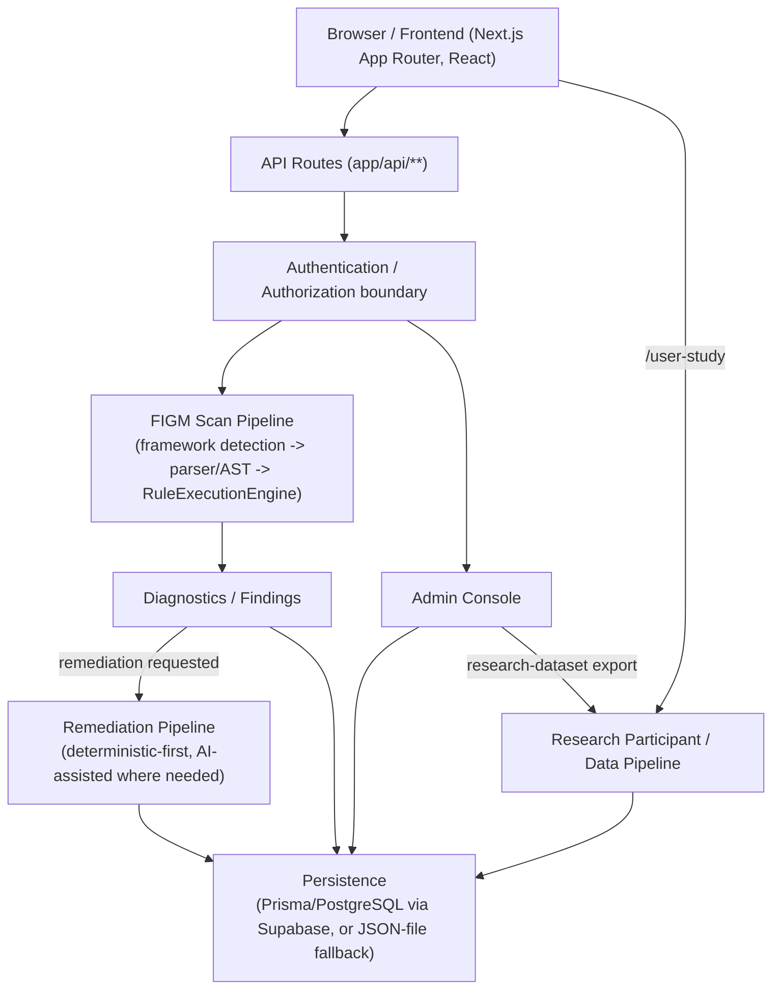
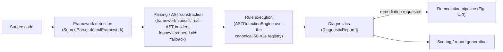
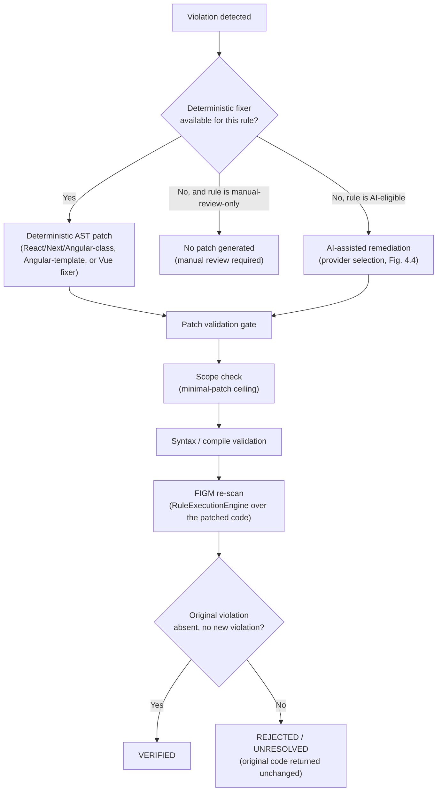

# Chapter 4: System Implementation

## 4.1 Chapter Overview

This chapter describes how the Framework-Agnostic Guideline Model (FIGM) and its automated validation tool, whose formal specification and research methodology were presented in Chapter 3, were actually implemented. It covers the system as a whole — the Next.js web application, its API layer, and its persistence layer — before narrowing to the static-analysis pipeline itself: framework detection, source parsing and AST construction, the four-layer meta-model's implementation, and the canonical rule-execution engine. It then details framework-specific parsing support, the remediation architecture (deterministic-first, AI-assisted where needed, and the validation gate a proposed patch must pass before acceptance), the AI provider architecture, authentication and authorization, the persistence and data model, the admin console and research-data pipeline, deployment architecture, testing architecture, and the scope of the system's security-adjacent functionality. Every claim in this chapter is grounded directly in the current repository source; results and evaluation outcomes are reserved for Chapters 5 and 6.

## 4.2 Overall System Architecture

FIGM is implemented as a single Next.js web application combining the static-analysis engine with a full product surface — developer accounts, scan history, an admin console, and a research-participant pipeline — rather than as an isolated command-line rule engine alone (a CLI entry point also exists, §4.5.4). Figure 4.1 summarises the overall flow a request takes through the system.

**Figure 4.1.** Overall system architecture.

Four major subsystems sit on top of this shared pipeline:

1. **The ordinary developer workflow** — an authenticated (or anonymous, for a single ad hoc scan) user submits source code, receives diagnostics, optionally requests remediation, and, if authenticated, has the scan persisted to their own scan history and, optionally, a project.
2. **Scan history and projects** — authenticated users can browse prior scans and group them under projects, backed by the `ScanReport` and `Project` persistence models (§4.10).
3. **The admin console** — role-gated views over users, participants, scans, rule statistics, and website analytics, with a distinct, narrower API-level access boundary than the page-shell boundary (§4.11).
4. **The research participant and data pipeline** — a separate, anonymous-entry flow (`/user-study`) through which consenting participants scan a fixed set of fixtures, gated at both a session-token level and an administratively-verified consent level before any of their data is eligible for the research dataset (§4.11).

| Component | Responsibility | Primary implementation location |
|---|---|---|
| Frontend (Next.js App Router, React) | Collects input, renders results; performs no analysis itself | `app/` |
| API layer | Request handling, auth enforcement, orchestration of the scan/remediation pipeline | `app/api/**/route.ts` |
| Authentication/authorization | Session issuance/verification, role checks, ownership scoping | `src/auth/` |
| FIGM scan pipeline | Framework detection, parsing/AST construction, rule execution | `src/parser/`, `src/ast/`, `src/engine/` |
| Remediation pipeline | Deterministic and AI-assisted patch generation and verification | `src/ai/` |
| Persistence | Prisma/PostgreSQL (Supabase) with a JSON-file fallback provider | `prisma/`, `src/storage/`, `src/db/` |
| Admin console | Role-gated operational and research-data views | `app/admin/`, `app/api/admin/` |
| Research pipeline | Participant assignment, consent, dataset eligibility, export | `src/engine/participant-repository.ts`, `app/user-study/`, `app/api/user-study/` |

**Table 4.1.** Major system components.

## 4.3 Frontend Application Architecture

The frontend is a Next.js 14 application (`"next": "^14.1.0"`) using the **App Router** exclusively — no `pages/` directory exists; every route is a `page.tsx` (or `route.ts` for an API handler) under `app/`. React is at version 18.2.0. Routing is organised as a flat set of top-level directories rather than Next.js route groups; a shared `app/layout.tsx` (root, server component) wraps every page in `AppShell.tsx` (a client component) which conditionally renders the product chrome (sidebar, header) around each page's content, suppressing that chrome for an explicit allow-list of "bare" routes — the authentication pages, the public marketing/research pages, and the isolated RQ1 experiment fixture routes (§4.5, Chapter 3 §3.4) — kept in sync by comment with the equivalent allow-list in `middleware.ts` (§4.9).

Architecturally, the frontend's routes fall into five responsibility groups:

- **Core scanning surface**: `app/live-scan/page.tsx`, the interactive scan UI, is the one page that imports a code-editor component (`@monaco-editor/react`) directly, consistent with its role as the primary code-entry surface.
- **Account and history surfaces**: the main authenticated dashboard (`app/page.tsx`), scan history and report/diagnostic detail views (`app/history`, `app/reports/[id]`, `app/diagnostics`, `app/diagnostics/[id]`), and account management (`app/projects`, `app/settings`, `app/profile`, `app/notifications`).
- **Admin console**: `app/admin/*`, each admin subtree carrying its own server-side layout guard (§4.9, §4.11).
- **Research-participant surface**: `app/user-study/page.tsx`, deliberately reachable without login, and the isolated `app/rq1-experiment/*` fixture routes used only by the RQ1 controlled experiment (Chapter 3 §3.4), rendered without any product chrome at all.
- **Public/unauthenticated surfaces**: authentication pages (`app/auth/*` plus top-level redirect stubs) and public informational pages (`app/about`, `app/methodology`, `app/guidelines`, `app/references`).

The frontend's role in the overall architecture (Figure 4.1) is to collect input (source code, credentials, consent, questionnaire responses) and present the results the API layer returns; it performs no static analysis itself — every scan, including the anonymous live-scan surface, is executed server-side (§4.4).

## 4.4 Backend and API Architecture

The backend is implemented entirely as Next.js API route handlers under `app/api/`, organised into route groups by responsibility: scanning (`/api/scan`, `/api/scans`), authentication (`/api/auth/*`), dashboard aggregates (`/api/dashboard/*`), projects (`/api/projects`), export (`/api/export`, `/api/export-dissertation`), research metrics (`/api/research-metrics`), health (`/api/health`), reporting (`/api/report`), search (`/api/search`), notifications (`/api/notifications`), settings (`/api/settings`), submissions (`/api/submissions`), profile (`/api/profile`), the research-participant pipeline (`/api/user-study/*`), and an admin group (`/api/admin/*`, §4.11).

A root `middleware.ts` applies CORS headers uniformly to every `/api/*` request and short-circuits CORS preflight requests, but deliberately does **not** enforce authentication at the middleware layer for API routes — each route calls its own `authenticateUser`/`authorizeRole` check (§4.9), a design choice recorded directly in the middleware's own comments.

**Ordinary user scan flow vs. research-participant scan flow.** These are two distinct paths through the API layer, sharing the same underlying scan engine but different persistence and eligibility semantics:

- **Ordinary flow**: `POST /api/scan` accepts source code (capped at 500KB) from any caller — authentication is optional, falling back to an anonymous guest identity if absent — applies per-IP and (for a remediation request) per-client-fingerprint rate limiting, runs the code through the FIGM scan pipeline (§4.5) via the asynchronous, non-blocking `RuleExecutionEngine.analyzeFileAsync` entry point, and, only if the caller is authenticated, persists the scan via `ScanRepository.createScanRecord`, reusing the exact quality-score and profiling figures already computed for the response (a deliberate design decision recorded in a code comment, closing a previously-real bug where a separately-recomputed persisted score disagreed with the one shown to the user). `POST /api/scans` is the equivalent history-write path used for durable scan-record creation, and, like the scan route, deliberately **ignores any client-supplied score or diagnostics**, re-deriving them from a fresh scan server-side, so a scan-history record cannot be forged by a client sending fabricated values.
- **Research-participant flow**: `POST /api/user-study/log-scan` performs the same underlying scan but writes the resulting record through the same `ScanRepository`/storage-provider path keyed to the participant's real `User.id`, and refuses to log anything at all unless the participant's session token carries `consentGiven: true` (§4.11).

## 4.5 FIGM Static Analysis Pipeline

The pipeline that turns submitted source code into diagnostics runs in five stages, described in turn below and summarised in Figure 4.2.

**Figure 4.2.** FIGM static analysis pipeline.

### 4.5.1 Framework Detection

`SourceParser.detectFramework()` (`src/parser/source-parser.ts`) first strips comment and string-literal text from the source (so a comment merely *mentioning* a framework name never causes a misclassification), then applies a layered set of structural checks, in order:

1. **Next.js** — detected as a distinct framework from React, via App/Pages Router file-role heuristics (a `page.`/`layout.` file under a router-shaped path) and/or content hints (`next/link`, `next/image`, `next/router`, `next/navigation`, `next/font` imports, or `getServerSideProps`/`getStaticProps`/exported `metadata`/`dynamic`/`revalidate`).
2. **Vue** — `.vue` file extension.
3. **Svelte** — `.svelte` file extension, detected for classification purposes but not one of the frameworks FIGM's rule catalogue actually targets (§4.6) — a detected-but-unsupported case, not an error.
4. **Angular** — structural regex requiring genuine syntax shape (`@Component(`, `<ng-template`, a `trackBy`/`[trackBy]` binding, or a real `from 'rxjs'` import) or an Angular-conventional filename (`.component.ts`/`.tsx`/`.js`).
5. **React (JSX/TSX)** — `.jsx`/`.tsx` extension, checked after the Next.js checks above.
6. **React (plain `.js`/`.ts`)** — requires a real import or call shape (`from 'react'`, `ReactDOM.`, or an actual `useState(`/`useEffect(`/`useMemo(`/`useCallback(` call), not a bare substring match.
7. **Generic JavaScript/TypeScript** — the fallback for any file matching none of the above.

### 4.5.2 Source Parsing and AST Construction

Once a file's framework is known, `SourceParser.parseSource()` builds a structured representation of it through one of several mechanisms depending on framework and rule, described in full per framework in §4.6. Two representations coexist in the current implementation:

- A **real, compiler-derived AST**, built by dedicated per-framework modules (`src/ast/real-syntax-node-builder.ts` for the TypeScript-compiler-backed frameworks; dedicated Vue and Angular-template builders, §4.6.3–4.6.4) and stamped with `sourceKind: 'REAL_AST'` on every node it produces.
- A **legacy, line-based text-heuristic scanner**, retained inside `SourceParser.buildASTFromCode()` as a resilient fallback: it strips comments/strings first and then applies a sequence of substring/regex checks (numbered in the source as a historical artefact of an earlier, purely-heuristic implementation), producing an AST-*shaped* intermediate representation without genuinely parsing the language grammar.

Every canonical rule's eligible frameworks now resolve to the real-AST path (§4.6); the legacy scanner remains load-bearing only where a rule is applied to a framework outside its real-AST eligibility gate — for example, a universal rule evaluated against a framework its real-AST builder does not cover. This provenance is not merely asserted: every `DiagnosticReport` carries a `sourceKind` field recording whether the specific finding it represents came from the real-AST path or the legacy path, making the claim independently checkable against the tool's own live output rather than only against this text.

### 4.5.3 Four-Layer Meta-Model Implementation

The Domain → Concern → Abstract Language Primitive → Rule hierarchy specified formally in Chapter 3 (§3.3) is implemented as a single canonical data structure, `FOUR_LAYER_MAPPINGS` (`src/matrix/four-layer-meta-model.ts`), where each entry carries its domain, concern, abstract language primitive, and rule definition together. `src/research/research-config.ts` records the catalogue's version identifier, `ruleSetVersion: '2.1.0'`. This chapter treats the meta-model's *implementation location* as its concern; its formal specification and derivation methodology were already presented in Chapter 3 and are not repeated here.

### 4.5.4 Canonical Rule Registry and Execution Engine

`src/matrix/rule-registry.ts` reshapes `FOUR_LAYER_MAPPINGS` into `RULE_CATALOG`, with `TOTAL_RULE_COUNT` derived directly from its length rather than a separately maintained literal — currently **50 canonical rules**. Framework applicability is not uniform across the catalogue: a rule may be universal (applicable across multiple frameworks, e.g. the `FIGM-PERF-*` series) or framework-scoped by design (e.g. every `FIGM-ANG-*` rule applies only to Angular, every `FIGM-VUE-*` rule only to Vue); §4.6 details this per framework.

`RuleExecutionEngine` (`src/engine/rule-execution-engine.ts`) is the coordinating class: `buildScanResult()` runs `SourceParser.parseSource`, `ComplexityEngine.analyzeComplexity`, and `TypeCheckerService.checkCode`, then hands the resulting representation to `ASTDetectionEngine.evaluateNode()` (`src/ast/ast-detection-engine.ts`) to evaluate the applicable rule predicates and to `ALPExtractionEngine` to extract the relevant Abstract Language Primitives, accumulating the results as `DiagnosticReport[]`. Two entry points exist: a synchronous `analyzeFile()` (used by the CLI and the test suite) and an asynchronous `analyzeFileAsync()` (used by the live web server), the latter running its dynamic-profiling component as a genuinely non-blocking child process so a single slow analysis cannot stall concurrent requests on the same server.

Each `DiagnosticReport` (`src/types/ast-spec.ts`) carries, at minimum, the violated rule's identifier, name, domain, concern, and severity; the file, precise location, and offending code snippet; a human-readable message and remediation suggestion; a standard-reference field tying the finding back to its WCAG/ISO grounding (Chapter 3, §3.3); a `sourceKind` provenance field (§4.5.2); and a fixability classification consumed by the remediation pipeline (§4.7).

The tool also exposes a standalone CLI entry point, `figm-analyze` (`src/cli/figm-analyze.ts`, wired as both a `package.json` `bin` and an `npm run analyze` script), accepting a target path plus `--format` (`json`/`html`/`console`/`both`), `--out`, `--threshold`, `--ignore`, and `--framework` flags, for use outside the web application (for example, in the CI workflow described in §4.12).

## 4.6 Framework-Specific Analysis Support

FIGM's guideline model is framework-agnostic by design (Chapter 3, §3.3), but its detection *mechanism* is necessarily framework-specific: each framework's syntax requires its own parser. This section describes that parsing support per framework, and states plainly where a rule does or does not apply to a given framework.

| Framework | Role | Parser(s) used | Rules targeting it |
|---|---|---|---|
| React | Primary | TypeScript Compiler API (shared `TypeScriptFrameworkParser`); a dedicated scope-aware visitor for `FIGM-REACT-02` | 11 `FIGM-REACT-*` rules |
| Next.js | Primary | Same TypeScript-Compiler-backed path as React, with Next.js-specific detection signals | 10 `FIGM-NEXT-*` rules |
| Angular | Primary | TypeScript Compiler API (class body) + `angular-html-parser` (inline template markup) | 10 `FIGM-ANG-*` rules |
| Vue.js | Additional support | `@vue/compiler-sfc` (block splitting) + `@vue/compiler-dom` (template) + TypeScript Compiler API (script/script-setup) | 6 `FIGM-VUE-*` rules |
| Generic JS/TS | Supported where genuinely implemented, not a research framework | TypeScript Compiler API | Universal rules only (no framework-scoped rules apply) |

**Table 4.2.** Framework parsing support.

### 4.6.1 React

React source (`.jsx`/`.tsx`, or plain `.js`/`.ts` files exhibiting real React import/call shapes) is parsed via the TypeScript Compiler API (`ts.createSourceFile`), shared through `TypeScriptFrameworkParser` (`src/parser/typescript-framework-parser.ts`) with Next.js and generic JS/TS. The 11 `FIGM-REACT-*` rules target React-specific concerns (state mutation, hook usage, list-key stability, memoisation, and related patterns). One rule, `FIGM-REACT-02` (array-index-used-as-list-key), is evaluated through a separate, dedicated real-AST path (`src/analysis/react-ast-rules.ts`) rather than through the shared general-purpose builder, using a scope-aware visitor that walks up from a JSX `key` attribute to the nearest enclosing `.map()` callback and checks whether the key expression genuinely references that callback's own index parameter — a real scope question, not a name-pattern match, correctly handling an index parameter under any name and a template-literal key derived from it.

### 4.6.2 Next.js

Next.js source is detected as its own framework (§4.5.1) and parsed through the same TypeScript-Compiler-backed path as React, since Next.js source is standard JSX/TSX with Next.js-specific conventions (App/Pages Router file roles, `next/*` APIs) layered on top. The 10 `FIGM-NEXT-*` rules target these conventions specifically — for example, the presence of a `"use client"` directive relative to client-only hook usage, dynamic-import usage for heavy modules, App Router route-segment revalidation configuration, and `next/font`/`next/image` usage in place of unoptimised native equivalents.

### 4.6.3 Angular

Angular components combine a TypeScript class body with a separate template syntax, and FIGM parses these two parts through two different real parsers:

- The **TypeScript class body** — including decorator metadata, constructor logic, and RxJS subscription patterns — is parsed via the same TypeScript Compiler API used for React/Next.js.
- **Inline template markup** — an Angular component's `template: \`...\`` backtick property, including modern `@for`/`@if`/`@switch` control-flow syntax — is parsed via `angular-html-parser`, a real, independently-maintained HTML-and-Angular-template parser extracted from Angular's own compiler tooling (distinct from the full `@angular/compiler` package), giving genuine element/attribute/directive/interpolation nodes with real source spans (`src/ast/angular-template-ast-builder.ts`).

Of the 10 `FIGM-ANG-*` rules, some (for example, unsubscribed RxJS observables, `OnPush` change-detection strategy, `Renderer2` usage) operate on the class body; others (for example, `*ngFor`/`@for` `trackBy` usage, template method-call detection, duplicate async-pipe usage) operate on template markup and use the `angular-html-parser` path. One limitation is stated explicitly rather than left implicit: only an *inline* `template:` property in the same file is parsed this way — a component using a separate `templateUrl` file is not currently covered by the template-markup parser.

### 4.6.4 Vue.js — Additional Support

Vue is supported by the automated validation tool as **additional implementation support**, not as one of the three primary research frameworks (React, Next.js, Angular) the guideline model was derived from and evaluated against (Chapter 1, §1.10; Chapter 3, §3.3.1). Within that scope, Vue support is fully implemented via real parsing, not a text heuristic: `@vue/compiler-sfc` splits a single-file component into its `<template>`, `<script>`/`<script setup>`, and `<style>` blocks (`src/parser/vue-sfc-parser.ts`); the template block is parsed by `@vue/compiler-dom`, passed explicitly as the compiler to use (`src/ast/vue-template-ast-builder.ts`); and the script block's content is parsed by the same TypeScript Compiler API used elsewhere (`src/ast/vue-framework-adapter.ts`). All six `FIGM-VUE-*` rules — two operating on template markup (unstable `v-for` key usage; combined `v-if`/`v-for` usage) and four operating on the script block (computed-getter side effects, computed-result mutation, direct prop mutation, and Options-API arrow-function methods) — are detected via this real-AST path, merged unconditionally for Vue files. An earlier point in this project's history documented Vue template parsing as blocked on package-registry access to install a real parser, falling back to a text heuristic in the interim; this is no longer the case, and this chapter describes the current, real-AST state, not that earlier limitation.

## 4.7 Remediation Architecture

Once a violation is found, FIGM attempts to remediate it through a deterministic-first pipeline, falling back to AI assistance only where no deterministic fixer applies, and accepting a proposed patch only after it passes a validation gate that concludes with a genuine re-scan. Figure 4.3 summarises this flow.

**Figure 4.3.** Remediation and verification pipeline.

### 4.7.1 Deterministic Remediation

`AIRemediationRouter.route(ruleId)` (`src/ai/ai-remediation-router.ts`) determines, for a given rule identifier, which remediation path applies, checking in order: `AstDeterministicFixEngine.isEligible` (React, Next.js, and Angular class-body fixes), `AngularTemplateFixEngine.isEligible`, `VueAstFixEngine.isEligible`, and a fixed set of rules explicitly marked manual-review-only (currently `FIGM-NEXT-08`, `FIGM-NEXT-09`, `FIGM-REACT-06`) — only falling through to the AI-assisted path if none of these claim the rule. `decideRemediation()` (`src/ai/remediation-decision.ts`) then genuinely invokes the routed deterministic engine before finalising a decision; if it declines for the specific instance, the decision narrows to AI-assisted. Every deterministic engine gets first refusal on a rule, by construction, before any AI provider is ever consulted.

### 4.7.2 AI-Assisted Remediation

Where no deterministic fixer exists or succeeds for a given instance, `AIRemediationPipeline.remediateDefect()` (`src/ai/ai-remediation-pipeline.ts`) requests a patch from the currently active AI provider (§4.8), via a shared `AIRemediationProvider` interface every provider implements identically. A structured prompt is built from the violation and its surrounding context (`AIPromptBuilder`), the provider's response is parsed into a candidate patch (`AIResponseParser`), and up to three attempts are made in total, with the specific failure of a rejected attempt fed back to the model on the next try. If every attempt is exhausted, declined, or the active provider is unavailable, the pipeline returns an explicit "no automated fix available" result — the original source is returned unchanged; no other engine is invoked to manufacture a substitute patch, a design choice stated explicitly in the pipeline's own source comments.

### 4.7.3 Patch Validation and Re-scan Verification

Every candidate patch, deterministic or AI-generated, passes through a multi-stage validation pipeline before it can be accepted:

1. **Isolation** — the patch is written to a real, isolated temporary file, never applied in place until validated.
2. **Syntax** — the patched file is re-parsed by the TypeScript compiler (or the relevant framework's parser) and checked for new parse errors.
3. **Scope** — a line-diff (a real longest-common-subsequence comparison, not a heuristic guess) computes the proportion of the file that changed; a patch changing more than 60% of the file's lines is rejected outright as looking like a broader rewrite rather than a scoped fix for one violation — an explicit, disclosed heuristic, not a claim that every large change is necessarily wrong.
4. **Framework-structural check** — a framework-appropriate structural validation appropriate to the file (e.g. that a React component's JSX structure remains well-formed).
5. **Compile and re-scan** — a full TypeScript type-check, followed by a genuine re-scan of the patched code through `RuleExecutionEngine`, the same engine used for the original scan (not a cached or simulated result).
6. **Test stage** — where a co-located automated test exists for the affected code, it is run as a further check.

**A patch is marked `VERIFIED` only if it passes every stage above, and specifically only if the re-scan in Stage 5 confirms the originally-reported violation is genuinely absent from the patched code and no new violation has been introduced.** No code path in the current implementation sets a patch's verified status before this re-scan has run and passed; a patch that fails any stage is returned as `REJECTED`/`UNRESOLVED`, with the original source left unchanged, rather than presented as fixed.

## 4.8 AI Provider Architecture

FIGM's AI-assisted remediation path is built on a **provider abstraction with three currently implemented providers**, not a single fixed provider. `src/ai/providers/ai-remediation-provider.ts` defines a shared `AIRemediationProvider` interface (`providerName`, `generateRemediation()`); `src/ai/providers/claude-provider.ts`, `gemini-provider.ts`, and `ollama-provider.ts` each implement it.

| Provider | Mechanism | Default model | Selected via |
|---|---|---|---|
| Ollama | Local HTTP API (`/api/generate`), no SDK dependency | `qwen2.5-coder:7b` | `OLLAMA_BASE_URL`/`OLLAMA_MODEL` configured |
| Claude (Anthropic) | `@anthropic-ai/sdk` | `claude-opus-5` | `ANTHROPIC_API_KEY` configured |
| Gemini (Google) | `@google/genai` | `gemini-3.6-flash` | `GEMINI_API_KEY` configured |

**Table 4.3.** AI provider roles.

`AIProviderSelector.getActiveProvider()` (`src/ai/ai-provider-selector.ts`) resolves the active provider in this order: an explicit `AI_PRIMARY_PROVIDER` override, if set and actually configured; otherwise **Ollama, if configured; otherwise Claude, if `ANTHROPIC_API_KEY` is set; otherwise Gemini, if `GEMINI_API_KEY` is set; otherwise a no-op stub** that returns an `AI_UNAVAILABLE` result without making any network call. A separate `getFallbackProvider()` handles a mid-remediation failure of the primary provider, defaulting to Claude → Gemini → Ollama (skipping whichever provider just failed), also overridable via `AI_FALLBACK_PROVIDER`.

**On Qwen, specifically.** A distinct, standalone Qwen provider integration was implemented and tested earlier in this project's history (a dedicated provider module and three test files existed in the repository's git history) and was subsequently, deliberately removed — confirmed directly from the project's commit history, which records the removal explicitly as resolving an architectural ambiguity between two disagreeing descriptions of the provider set. **Qwen is not a current, standalone provider integration.** The only place "Qwen" appears in current, live code is as the **default model tag Ollama is configured to serve** (`qwen2.5-coder:7b`) — an open-weight model served generically through the Ollama provider's HTTP API, exactly as Ollama could equally be configured to serve a different model. The distinction is precise: the **provider** is Ollama; `qwen2.5-coder:7b` is a **model** Ollama happens to be configured to request by default. A small number of comments elsewhere in the codebase (in the Gemini provider's response-handling code) refer to the removed Qwen provider's historical response quirks for comparison; these are inert documentation, not an active code path.

**Configuration status, distinguished precisely per the categories this is best described in:**

- **Implemented** (code exists and is exercised by the test suite): Ollama, Claude, Gemini — all three.
- **Selectable** (reachable via the precedence/override logic above): all three, subject to the configuration conditions in the table.
- **Configured in any specific deployment**: not established by this chapter — this dissertation does not have visibility into which API keys are actually set in a live deployment's environment, and makes no claim about which provider is active in production as a result. Environment-variable *names* are documented (§4.12); their *values* are never reproduced here.
- **Production-ready on the project's actual deployment target (Vercel)**: Claude and Gemini are network-reachable, API-key-based services and are architecturally deployable; **Ollama is not**, and this is stated explicitly in the project's own environment documentation — Vercel's serverless runtime has no network path to a local machine's Ollama instance, so Ollama variables are documented as development-only and must never be set in a deployed environment (§4.12).
- **Fallback behaviour**: as described above — Claude → Gemini → Ollama on a primary-provider failure, and a genuine "no automated fix available" outcome, never a fabricated patch, if every option is exhausted or unavailable (§4.7.2).

**A note on an unrelated, unused dependency.** `package.json` currently lists `"openai": "^7.7.0"` among its dependencies. A repository-wide search finds **no current import of this package anywhere in the source tree**. This is an orphaned dependency, most plausibly a leftover from the since-removed Qwen provider's implementation (which likely used an OpenAI-compatible client library), and is not evidence of any active OpenAI integration; this chapter does not describe OpenAI as a supported provider, since no source code implements one.

## 4.9 Authentication and Authorization

FIGM implements its own JWT-based authentication (`src/auth/auth-service.ts`) rather than depending on a third-party auth library. Access and refresh tokens are signed with HS256 using Node's own `crypto` module, with a constant-time signature comparison to avoid a timing side-channel; passwords are hashed with scrypt, with backward-compatible verification (and transparent upgrade) of an older PBKDF2-based hash format from an earlier version of the system. Three roles exist — `ADMIN`, `DEVELOPER`, `AUDITOR` — and a role claim outside this set is clamped to `DEVELOPER` rather than trusted as-is.

Two further mechanisms enforce authorization beyond simply issuing a valid token:

- **Logout revocation.** Each user carries a `tokenVersion` counter in the database; a token embeds the version it was issued under, and `authenticateUser` (`src/auth/auth-middleware.ts`) rejects a token whose embedded version no longer matches the user's current one. Logout bumps this counter, which is what makes logout actually invalidate an already-issued token immediately, rather than only removing it client-side and leaving it valid until natural expiry.
- **Research-participant session isolation.** A research-participant session (§4.11) is signed with the same underlying secret but carries an explicit `kind: 'research_participant'` claim; `verifyJWT` rejects **any** token carrying a `kind` claim outright, meaning a research-participant token (or a refresh token, which carries `kind: 'refresh'`) can never be accepted as a real, ordinary user session on a product route, and conversely the participant-token verifier accepts only tokens actually carrying the matching `kind`. This closes a real, previously demonstrated privilege-escalation path (confirmed by a dedicated regression test) in which an anonymous research-participant token — obtainable by anyone visiting the public `/user-study` page, no login required — could otherwise have decoded as a structurally valid ordinary-user session.

At the routing level, `middleware.ts` applies an authenticated-by-default policy to page routes (a negative matcher covering virtually all paths, with an explicit allow-list of public pages), while API-route authentication and role authorization are enforced individually by each route via `authenticateUser`/`authorizeRole`. Ownership is checked at the data-access level, not only the route level: a caller can read or modify their own scans and projects, or — where explicitly authorized — an admin's, but the query itself is scoped to the caller's `userId` unless the caller's role is `ADMIN`. This means access control in FIGM is enforced server-side, in the API and data layers; hiding a link or a page section in the UI is never treated as, or substituted for, an authorization check.

## 4.10 Persistence and Data Model

FIGM uses Prisma (`@prisma/client ^7.9.1`) against a PostgreSQL database, provisioned via Supabase in practice (`prisma/schema.prisma`'s `datasource` provider is `postgresql`; Supabase-specific connection details live in environment configuration, not the schema itself). Table 4.4 summarises the main models and their architectural responsibility.

| Model | Responsibility |
|---|---|
| `User` | Account identity and credentials; role; logout-revocation counter; research-participant fields (`participantCode`, `researchStatus`, `researchAssignedAt`, `researchConsentVerifiedAt`) |
| `Project` | A named grouping of a user's scans, with an aggregate quality score |
| `ScanReport` | A single scan's persisted result — framework, timing, per-severity finding counts, and the full diagnostics payload |
| `Notification` | In-app notifications for a user |
| `AuditLog` | Security- and research-relevant event log (login attempts, research consent verification/revocation, etc.) |
| `Settings` | Per-user preferences (theme, auto-save/auto-scan behaviour, preferred AI model, export format) |
| `ApiKey`, `SavedReport`, `ResearchEvaluation`, `FrameworkBenchmark`, `AiHistory`, `ExportHistory` | Supporting models for API access, saved reports, research-evaluation bookkeeping, benchmark history, AI-remediation history, and export history respectively |
| `Submission` | A dedicated model for the `/api/submissions` scan-and-persist flow, added specifically to close a prior gap where that route bypassed the storage-provider abstraction entirely |

**Table 4.4.** Persistence entities and responsibilities.

Scan-history writes are **server-authoritative**: `POST /api/scans` and the persistence branch of `POST /api/scan` both deliberately discard any client-supplied quality score or diagnostics and re-derive them from a fresh server-side scan, so a scan-history record cannot be forged by a client submitting fabricated results.

A second storage mechanism coexists alongside Prisma/Postgres: `RepositoryFactory` (`src/storage/repository-factory.ts`) selects between a `SupabaseStorageProvider` and a `JsonStorageProvider` behind a shared `IStorageProvider` interface. This is not a silent, accidental fallback: outside `development`/`test`, the factory now fails closed — it throws rather than silently degrading to JSON-file storage — unless either real Supabase credentials are present or `STORAGE_PROVIDER=json` is explicitly set, a hardening against an earlier failure mode where JSON-file storage on a serverless platform's ephemeral filesystem could appear to work correctly while actually losing data between requests. `GET /api/health` reports which provider is actually live at runtime, confirming both paths remain genuinely reachable rather than one being dead code.

## 4.11 Admin and Research Data Pipeline

The admin console (`app/admin/*`) presents ten tabs — overview, users, participants, scans, research, frameworks, rules, website analytics (GA4), audit, and health — gated at two distinct levels: the page shell itself is reachable by either `ADMIN` or `AUDITOR` role, but every admin **API** route requires `ADMIN` specifically, and the participant-detail subtree additionally excludes `AUDITOR` at the page level, keeping participant personal data restricted to `ADMIN` even at the UI layer.

**Participant assignment.** `ParticipantRepository.assignNewParticipant()` (`src/engine/participant-repository.ts`) allocates the smallest currently-unused `P###`-format identifier, collision-safe against a database unique-constraint conflict, up to the configured target of 20 (`HUMAN_STUDY_TARGET_PARTICIPANTS`, Chapter 3 §3.8).

**Consent — two distinct mechanisms.** A participant's anonymous session first records a lightweight, session-token-level consent click-through (`POST /api/user-study/consent`, re-signing the participant's session token with `consentGiven: true`); this is what gates whether `log-scan` will record anything for that session at all. Separately, and this is the mechanism that actually governs research-dataset eligibility, an administrator reconciles a real external consent/questionnaire submission against a participant code and calls `ParticipantRepository.setResearchStatus()`, which sets the participant's `researchStatus` to `CONSENT_VERIFIED` (or `REVOKED`) and, for verification, stamps `researchConsentVerifiedAt` on the `User` row.

**Research-dataset inclusion.** `ParticipantRepository.getResearchDataset()` applies the same eligibility rule stated in Chapter 3 (§3.8): a user's scans are eligible only if the user's participant code falls within the genuine study range (`P001`–`P020` specifically, not merely any code matching the broader `P\d{3,6}` shape used for other purposes — this range restriction is implemented, not merely intended, as a guard against out-of-range QA/test fixture codes being mistaken for research data), `researchStatus === 'CONSENT_VERIFIED'`, `researchConsentVerifiedAt` is non-null, and the individual scan's timestamp is at or after that consent timestamp. Eligible scans are then classified `PRIMARY` (the earliest eligible scan for a given participant × fixture pairing) or `SECONDARY` (any later one), exactly as specified in Chapter 3.

**Research-dataset export.** `GET /api/admin/research-dataset` (`app/api/admin/research-dataset/route.ts`), `ADMIN`-only, calls this same `getResearchDataset()` method and returns the result as JSON or, on request, a downloadable CSV — it does not redefine eligibility independently; it inherits it entirely from the canonical repository method described above, so the export can never diverge from the eligibility rule the rest of the system enforces. This route did not exist at an earlier point in this project's history and represents current, verified functionality.

**Exclusions, stated explicitly:** an ordinary developer account (no qualifying participant code or research status) is excluded by construction; a scan performed before consent was verified is retained operationally (so a participant's own in-app history is not destroyed) but excluded from the research dataset by the timestamp filter; a participant whose status has been set to `REVOKED` is excluded entirely, since that status does not match the `CONSENT_VERIFIED` filter; and a participant code outside the genuine `P001`–`P020` study range — including synthetic or QA/test fixture codes — is excluded by the range guard described above.

## 4.12 Deployment Architecture

FIGM is deployed to **Vercel** as a Next.js application (`vercel.json`: build command `npx prisma generate && next build`, framework `nextjs`), with a linked Vercel project directory present in the repository indicating the application has actually been deployed there, not merely configured hypothetically for it.

Required deployment configuration falls into three categories (names only; no value is reproduced here):

- **Required for production**: authentication secrets (`JWT_SECRET`, `REFRESH_SECRET`), an admin-bootstrap password used only for first-run seeding, Supabase connection details (`NEXT_PUBLIC_SUPABASE_URL`, `NEXT_PUBLIC_SUPABASE_ANON_KEY`, `SUPABASE_SERVICE_ROLE_KEY`), database connection strings (`DATABASE_URL`, `DIRECT_URL`), and `NODE_ENV`.
- **Optional for production**: a storage-provider override, AI-provider keys and model overrides for Claude and Gemini, an analytics measurement ID, and the application's public URL.
- **Development-only**: the Ollama connection variables and a test-only reset-token override — the project's own environment documentation states explicitly that the Ollama variables must never be set in a deployed environment, since Vercel's serverless runtime has no network path to reach a local machine's Ollama instance. No alternative mechanism (a tunnel, a proxy, or similar) for reaching a local Ollama instance from the deployed application exists in the current implementation; Ollama is, architecturally, a local-development-only provider option on this deployment target.

A GitHub Actions workflow (`.github/workflows/figm-scan.yml`) builds the application, runs the automated test suite (deliberately without a real production database connection — falling back to the JSON-file storage provider for the duration of the CI run, so CI never touches live production data), runs FIGM's own static-analysis engine against its own codebase ("dogfooding"), and uploads the resulting report as a build artifact and PR comment. This workflow performs continuous integration and self-verification; it does **not** itself deploy the application — actual deployment to Vercel is handled separately, through Vercel's own Git integration, outside this workflow.

## 4.13 Testing Architecture

The project's automated test suite comprises 134 test files under `tests/`, executed via **Node's own built-in test runner** (`node --test`, invoked through `tsx` for on-the-fly TypeScript transpilation) rather than a third-party framework such as Jest or Vitest, run at a deliberately serialized concurrency of one, since a number of tests share a real local JSON-file storage backend and its state.

Test coverage spans several categories relevant to this chapter: rule and AST detection (per-rule and per-framework parsing correctness), remediation and AI-fix engines (including dedicated integration tests for each of the Claude, Gemini, and Ollama providers), API and security behaviour (authentication isolation, access-control regressions, timing-attack regressions, and the specific research-participant/ordinary-user token-isolation guarantee described in §4.9), and the research pipeline (the consent-gate filter, the participant-range guard, the repeated-scan PRIMARY/SECONDARY policy, and a participant-provisioning race-condition regression). As noted above, the default test run does not connect to the real production database — it exercises the JSON-file storage path instead — which is the project's current mechanism for keeping automated testing from ever touching live production or research data; this is a deliberate configuration choice in the CI workflow rather than a separate, dedicated test database instance.

## 4.14 Security Scope

FIGM's product implementation includes security-adjacent functionality — authentication, role-based authorization, rate limiting, security headers, and audit logging — as **supplementary functionality supporting the research artefact**, not as a research contribution in its own right (Chapter 1, §1.10; Chapter 3, §3.12). Concretely: `next.config.mjs` applies a restrictive Content-Security-Policy and standard hardening headers (`X-Content-Type-Options`, `X-Frame-Options`, HSTS, a restrictive `Permissions-Policy`) to every route; CORS uses an explicit origin allow-list with credentials never enabled; the application's cross-site-request-forgery posture rests on its use of header-based Bearer-token authentication for API calls (rather than automatic, credentialed cookie transmission) combined with this strict CORS policy, rather than a separate, dedicated CSRF-token mechanism; and both scan requests and AI-remediation requests are rate-limited, with an additional per-client-fingerprint limit specifically on remediation requests given their higher cost. This chapter describes this functionality as it exists; it does not, and this dissertation does not elsewhere, claim a deep security vulnerability assessment or penetration test was performed, which remains explicitly out of scope (Chapter 1, §1.10).

## 4.15 Chapter Summary

This chapter described FIGM's implementation as a whole system — a Next.js frontend and API layer, a static-analysis pipeline built around framework detection, real-AST parsing per framework, and a canonical 50-rule execution engine, a deterministic-first remediation architecture with a three-provider AI abstraction and an unconditional re-scan-before-verified gate, an authentication and authorization layer with a specific, tested guarantee separating research-participant sessions from ordinary ones, a dual-provider persistence layer, an admin console and research-data pipeline whose export functionality inherits its eligibility logic directly from the same rule the rest of the system enforces, and its deployment and testing architecture. Chapter 5 now reports the empirical results this implementation produces against the methodology Chapter 3 specified.
