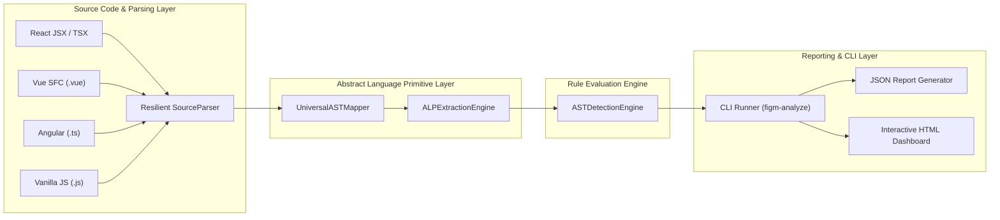
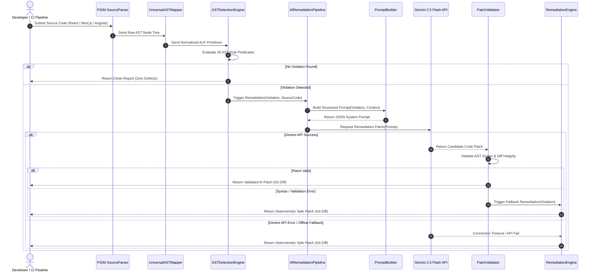

# Chapter 4: System Implementation & Parsing Architecture

## 4.1 Analyzer System Architecture Overview

The FIGM static analysis architecture is organized into four decoupled processing layers:



---

## 4.2 Resilient Source Code Parser Adapter

Static analysis of modern web applications requires handling heterogeneous template syntaxes and incomplete or malformed code blocks. The `SourceParser` adapter provides resilient AST node generation:

```typescript
export class SourceParser {
  public static parseSource(code: string, filePath: string): ParseResult {
    const framework = this.detectFramework(filePath, code);
    const errors: Array<{ line: number; column: number; message: string }> = [];

    try {
      const rootNode = this.buildASTFromCode(code, framework, errors);
      return { filePath, framework, ast: rootNode, parseErrors: errors };
    } catch (err) {
      errors.push({ line: 1, column: 1, message: err instanceof Error ? err.message : 'Syntax error' });
      return { filePath, framework, ast: { type: 'Program', children: [] }, parseErrors: errors };
    }
  }
}
```

### 4.2.1 Framework Detection Matrix
The parser inspects file extensions and structural syntax keywords:
* `.tsx`, `.jsx`, or `import React`: Mapped to `REACT_JSX`.
* `.vue`: Mapped to `VUE_SFC`.
* `.component.ts` or `@Component`: Mapped to `ANGULAR_TEMPLATE`.
* `.js` or `.ts`: Mapped to `GENERIC_ESTREE`.

---

## 4.3 ALP Extraction Engine

The `ALPExtractionEngine` traverses normalized AST node graphs and maps framework-specific syntactic constructs (e.g. React `onClick` attributes, Vue `v-on:click` directives, Angular `(click)` output bindings) to generic FIGM Abstract Language Primitives (ALPs):

| Framework Syntax | Native Node Type | Extracted FIGM ALP Target |
| :--- | :--- | :--- |
| `<div onClick={fn}>` | `JSXElement` | `ALP-EVENT-KEYBOARD` |
| `` | `JSXElement` / `VElement` / `Element$1` | `ALP-LAYOUT-ELEMENT` |
| `window.addEventListener('scroll', fn)` | `CallExpression` | `ALP-ASYNC-DISPOSAL` |
| `items.map(() => ({ item }))` | `CallExpression` + `ObjectExpression` | `ALP-LOOP-ALLOC` |
| `<CustomSelect />` | `JSXElement` | `ALP-ARIA-NAMING` |

---

## 4.4 Static Analyzer Rule Execution Engine

The `RuleExecutionEngine` coordinates static scanning across target directory trees. It parses each file, extracts ALPs, evaluates all 25 mathematical predicates, and accumulates structured `DiagnosticReport` records:

```typescript
export interface DiagnosticReport {
  ruleId: string;
  ruleName: string;
  domain: 'PERFORMANCE' | 'ACCESSIBILITY';
  concern: string;
  severity: 'CRITICAL' | 'HIGH' | 'MEDIUM' | 'LOW';
  filePath: string;
  location: { start: { line: number; column: number }; end: { line: number; column: number } };
  offendingCodeSnippet: string;
  message: string;
  remediation: string;
  standardReference: string;
}
```

---

## 4.5 CLI Runner & Interactive Dashboard Exporters

The analyzer exposes a command-line interface executable (`figm-analyze`):

```bash
# Scan target application directory and generate both JSON & HTML reports
figm-analyze ./src --format both --out figm-scan-report
```

### 4.5.1 Report Exporters
- **JSON Exporter**: Generates structured machine-readable JSON files (`figm-scan-report.json`) for CI/CD integration pipelines.
- **HTML Dashboard Exporter**: Generates self-contained interactive web dashboards (`figm-scan-report.html`) featuring CSS severity badges, score summary widgets, code snippet syntax displays, and standard traceability mappings.

---

## 4.6 AI-Assisted Remediation Sequence & Fallback Pipeline

The AI remediation pipeline (`AIRemediationPipeline`) integrates Gemini 2.5 Flash with an automatic deterministic fallback engine (`RemediationEngine`). The operational sequence is illustrated below:


